<div align="center">

# RedCake

**A Redis-compatible in-memory data store, written from scratch in Java 21 -
with what AI applications keep asking for: embeddings, records and durable jobs.**

Virtual threads · append-only persistence · replication with partial resync · automatic failover through ZooKeeper ·
TLS and ACLs · HNSW vector search · JSON documents · streams with consumer groups


</div>

RedCake speaks RESP2 over TCP, so `redis-cli`, `redis-benchmark` and the Redis client libraries that use RESP2 talk to it
unchanged (a client that asks for RESP3 first, such as recent `redis-py`, must be told to use RESP2: `protocol=2`). Under the
protocol sits a small, readable engine: **one ordered write path** that feeds the append-only file and every replica from
the same sequence, **lock-free reads**, a **ZooKeeper-backed election** that lets at most one node acknowledge writes at a
time, a **vector index** that keeps similarity search off the write lock, **JSON documents** whose fields are read and
changed by path, atomically, and **streams** that keep a job until a worker has finished it - with readers that wait for
work without holding a lock. Spring Boot is used for wiring and lifecycle only; every data structure, protocol and
replication detail is plain Java in this repository.

> **Status: experimental.** Good for learning, local development, protocol experiments, benchmarking and for studying how
> an in-memory database fits together. It is **not** a drop-in production Redis: RESP2 only, no sharded cluster, no
> Lua, some collection commands are O(n). Every limitation is listed in [section 11](#11-limitations-and-roadmap).

## The idea: the toolbox of an AI application

An application that calls models keeps three kinds of state: **records** (a text, its embedding, metadata, a status),
**vectors** to search by meaning, and **jobs** that must not get lost. RedCake keeps all three in one process, persists and
replicates them the same way, and moves between them with ordinary commands:

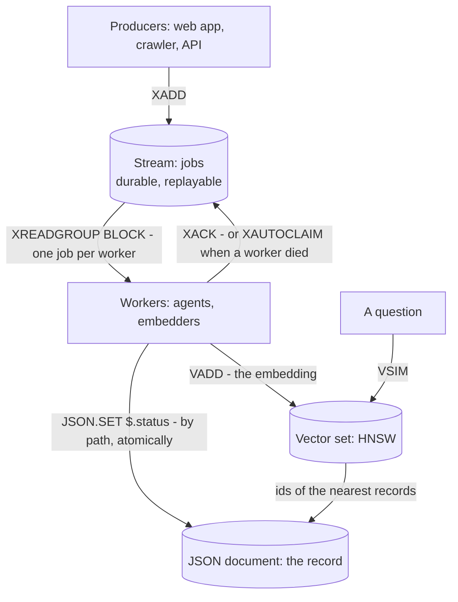

| You need to ... | Use | In RedCake |
|---|---|---|
| keep a **record** and change one field of it atomically | JSON documents | `JSON.SET doc:1 $.status '"done"'` - [4.12](#412-json-documents) |
| find what is **nearest to an embedding** | vector sets (HNSW) | `VADD`, `VSIM` - [4.11](#411-vector-search) |
| hand **jobs** to workers, lose none, retry what a dead worker left | streams with consumer groups | `XADD`, `XREADGROUP BLOCK`, `XACK`, `XAUTOCLAIM` - [4.13](#413-streams-and-consumer-groups) |
| tell whoever is online **right now** | Pub/Sub | `PUBLISH`, `SUBSCRIBE` |
| cache, count, rate-limit, expire | strings, hashes, sets, sorted sets, TTLs | `SET k v EX 60`, `INCR`, `ZADD` |

All of it is also the Redis you know: the same protocol, the same client libraries, the same `redis-cli`. A runnable version of
the diagram - a Python script with no model to download - is [`examples/agent_pipeline.py`](examples/agent_pipeline.py); its real
output is in [the tour](#3-a-five-minute-tour).

## At a glance

| | |
|---|---|
| **Protocol** | RESP2 over TCP, optional TLS / mutual TLS, inline commands (`telnet`, `nc`) |
| **Data types** | binary-safe strings, hashes, lists, sets, sorted sets, **vector sets**, **JSON documents**, **streams** |
| **Commands** | 164 names (143 in the registry + 21 handled at the connection level) |
| **Concurrency** | one virtual thread per connection; lock-free parallel reads; one ordered write path |
| **Durability** | append-only file with `always` / `everysec` / `no` fsync, crash-safe replay, atomic rewrite |
| **Replication** | asynchronous, partial resync from a backlog, `WAIT`, `--min-replicas-to-write` |
| **High availability** | opt-in ZooKeeper election with epochs, leases and write fencing; planned hand-over |
| **Vector search** | HNSW, int8 / float32 / 1-bit storage, SIMD kernel, searches never wait for the write lock |
| **JSON documents** | RedisJSON's `JSON.*` commands: JSONPath with filters, atomic changes by path, unboxed number arrays, RFC 7386 merge |
| **Streams** | the Redis Streams commands: durable queues, consumer groups, pending lists, `XAUTOCLAIM`; `BLOCK` reads that hold no lock; checked against Redis 7.4.2 |
| **Security** | protected mode, API key and ACL roles, brute-force lockout, TLS, bounded parser, resource limits |
| **Operations** | `INFO`, `SLOWLOG`, `MONITOR`, Prometheus, `/health`, Grafana dashboard, Docker, systemd unit |
| **Quality** | 494 automated tests ([what they prove](#9-testing)), 8 shell scripts for crash, soak, failover, smoke and benchmark runs, 464 stream commands replayed against the answers of a real Redis 7.4.2 |

## Contents

1. [What RedCake is and is not](#1-what-redcake-is-and-is-not)
2. [Quick start](#2-quick-start)
3. [A five-minute tour](#3-a-five-minute-tour)
4. [System design](#4-system-design)
   - [4.1 The big picture](#41-the-big-picture) · [4.2 Inside one node](#42-inside-one-node) · [4.3 Threads](#43-threads)
   - [4.4 Life of a command](#44-life-of-a-command) · [4.5 Data model](#45-data-model) · [4.6 Expiration](#46-expiration)
   - [4.7 Persistence (AOF)](#47-persistence-aof) · [4.8 Memory limit](#48-memory-limit) · [4.9 Replication](#49-replication)
   - [4.10 High availability](#410-high-availability-automatic-failover) · [4.11 Vector search](#411-vector-search)
     · [4.12 JSON documents](#412-json-documents) · [4.13 Streams](#413-streams-and-consumer-groups)
   - [4.14 Security](#414-security) · [4.15 Observability](#415-observability)
   - [4.16 Guarantees](#416-consistency-and-durability-guarantees) · [4.17 Design decisions](#417-design-decisions)
5. [Command reference](#5-command-reference)
6. [Configuration](#6-configuration)
7. [Deployment](#7-deployment)
8. [Performance](#8-performance)
9. [Testing](#9-testing)
10. [Troubleshooting](#10-troubleshooting)
11. [Limitations and roadmap](#11-limitations-and-roadmap)
12. [Repository map and documentation](#12-repository-map-and-documentation)
13. [Contributing, security, license](#13-contributing-security-license)

---

## 1. What RedCake is and is not

### Design principles

1. **One order of writes.** A primary executes writes one after another through a single lock. The same sequence goes to the
   append-only file, the replication backlog and every replica, so all of them agree by construction (ADR 0001).
2. **Nothing inside the lock waits on the network.** Under the lock a command is only *queued* for each replica; separate
   threads write to the sockets - and a reader that waits for a stream entry waits outside the lock too.
3. **Determinism.** Relative times become absolute (`EX 10` becomes `PXAT <ms>`) with one clock reading, expiry and eviction
   are logged as explicit `DEL`, a vector is rewritten to a canonical blob, `XADD *` is logged with the id it chose and
   `XREADGROUP` as what it handed out. Replaying the log or applying the stream yields the same data as the primary has.
4. **Fail closed.** A node that cannot prove it may accept writes refuses them: `-READONLY`, `-CLUSTERDOWN`, `-NOREPLICAS`,
   `-MISCONF`, `-OOM`. A primary that is cut off from ZooKeeper stops *before* a successor can exist.
5. **Reads never queue behind writes.** The store is a concurrent map; reads (including vector searches) run in parallel
   with each other and with the write path.
6. **Boring technology.** JDK data structures, blocking I/O on virtual threads, no native code, no reactive framework.
7. **Honest limits.** What is measured is marked as measured, what is not verified is marked as such.

### RedCake and Redis

| | Redis | RedCake |
|---|---|---|
| Command execution | one thread executes commands | virtual thread per connection; reads in parallel, writes serialized by one lock |
| Language / runtime | C | Java 21 on the JVM (the Docker image uses generational ZGC), no native code |
| Persistence | RDB snapshots and AOF | AOF only (normalized RESP commands, atomic rewrite) |
| Replication | RDB transfer, then command stream | own handshake over RESP; full sync is a stream of ordinary commands (ADR 0002) |
| High availability | Sentinel or Redis Cluster | ZooKeeper election with epochs and leases (ADR 0005); no sharding |
| Vector search | vector sets (Redis 8) | vector sets with the same command family, own HNSW (ADR 0006) |
| JSON documents | the RedisJSON module (Redis Stack, Redis 8) | the same `JSON.*` command family, built in, with unboxed number arrays (ADR 0007) |
| Streams | Streams: consumer groups, blocking reads | the same commands, replies and error texts (replayed against Redis 7.4.2), blocking reads on virtual threads, block-based storage (ADR 0008); `MAXLEN ~` trims exactly |
| Protocol | RESP2 and RESP3 | RESP2 only: `HELLO 3` answers `-NOPROTO`, and clients that do not fall back (recent `redis-py`) need `protocol=2` |

---

## 2. Quick start

**Requirements:** JDK 21 or newer (developed and tested with JDK 22). The Maven wrapper is included. `redis-cli`
(`sudo apt install redis-tools`) is handy but not required.

```bash
./mvnw clean package                                                  # builds and runs the 494 tests
java -jar target/redCake-0.0.1-SNAPSHOT.jar                           # primary on 127.0.0.1:6379
java -jar target/redCake-0.0.1-SNAPSHOT.jar --port 6381 --replicaof 127.0.0.1 6379     # a replica
redis-cli -p 6379 HSET user:1 name Nitesh
redis-cli -p 6381 HGETALL user:1                                      # served by the replica
scripts/smoke-test.sh 6379                                            # end-to-end checks with redis-cli
pip install redis && python3 examples/agent_pipeline.py               # JSON record + stream of jobs + vector search, end to end
java -jar target/redCake-0.0.1-SNAPSHOT.jar --help                    # every option
```

Several times faster vector search (optional, needs a JDK that ships the incubating Vector API module):

```bash
java --add-modules jdk.incubator.vector -jar target/redCake-0.0.1-SNAPSHOT.jar
# the log says which kernel was chosen:  "Vector search kernel: simd (16 float lanes, 512-bit)"  or  "scalar"
```

**Docker** (`docker-compose.cluster.yml` and the HAProxy example were written for this project and not executed in the authoring environment):

```bash
REDCAKE_API_KEY=change-me docker compose up --build                   # one primary + two replicas
docker compose --profile monitoring up                                # + Prometheus and Grafana
REDCAKE_API_KEY=change-me docker compose -f docker-compose.cluster.yml up --build   # ZooKeeper + 3 self-electing nodes
```

By default RedCake listens on loopback only and refuses to listen on another address without credentials
(`--api-key`/`REDCAKE_API_KEY`, `--acl-file`, or the explicit `--allow-insecure`).

---

## 3. A five-minute tour

Everything below was run against the packaged jar (a primary with `--aof-file` and `--metrics-port 9100`, a replica started with
`--replicaof`); the output is pasted from that session, only the port numbers were renamed to 6379 / 6381 / 9100. The streams and pipeline
blocks come from later sessions of the same jar (the streams one with `--aof-fsync always`) and are pasted the same way.

**Strings, hashes, lists, sets, sorted sets**

```text
127.0.0.1:6379> SET greeting "hello world" EX 60
OK
127.0.0.1:6379> GET greeting
"hello world"
127.0.0.1:6379> TTL greeting
(integer) 60
127.0.0.1:6379> INCR visits
(integer) 1
127.0.0.1:6379> INCRBY visits 10
(integer) 11
127.0.0.1:6379> HSET user:1 name Nitesh role admin
(integer) 2
127.0.0.1:6379> HGETALL user:1
1) "name"
2) "Nitesh"
3) "role"
4) "admin"
127.0.0.1:6379> LPUSH jobs build test deploy
(integer) 3
127.0.0.1:6379> LRANGE jobs 0 -1
1) "deploy"
2) "test"
3) "build"
127.0.0.1:6379> ZADD board 100 alice 250 bob 175 carol
(integer) 3
127.0.0.1:6379> ZRANGE board 0 -1 WITHSCORES
1) "alice"
2) "100"
3) "carol"
4) "175"
5) "bob"
6) "250"
127.0.0.1:6379> TYPE user:1
hash
```

**A transaction** (`MULTI` queues, `EXEC` runs the batch as one unit; `WATCH` makes it optimistic)

```text
127.0.0.1:6379> MULTI
OK
127.0.0.1:6379> INCR hits
QUEUED
127.0.0.1:6379> INCR hits
QUEUED
127.0.0.1:6379> EXEC
1) (integer) 1
2) (integer) 2
```

**Replication** (the replica serves reads, refuses writes, and `WAIT` tells you when it has caught up)

```text
127.0.0.1:6379> ROLE
1) "master"
2) (integer) 716
3) 1) 1) "127.0.0.1"
      2) "6381"
      3) "266"
127.0.0.1:6381> GET greeting
"hello world"
127.0.0.1:6381> SET x 1
(error) READONLY replica does not accept writes
127.0.0.1:6379> WAIT 1 1000
(integer) 1
```

**Vector search** (3 dimensions to keep it readable; real embeddings have hundreds; scores are `(cosine + 1) / 2`)

```text
127.0.0.1:6379> VADD points VALUES 3 1 0 0 east
(integer) 1
127.0.0.1:6379> VADD points VALUES 3 0 1 0 north
(integer) 1
127.0.0.1:6379> VADD points VALUES 3 0.9 0.1 0 near-east SETATTR '{"kind":"demo"}'
(integer) 1
127.0.0.1:6379> VSIM points VALUES 3 1 0.05 0 WITHSCORES COUNT 2
1) "east"
2) "0.9994429051876068"
3) "near-east"
4) "0.9990211129188538"
127.0.0.1:6379> VSIM points ELE north WITHSCORES WITHATTRIBS COUNT 3
1) "north"
2) "1"
3) (nil)
4) "near-east"
5) "0.5547862350940704"
6) "{\"kind\":\"demo\"}"
7) "east"
8) "0.5"
9) (nil)
127.0.0.1:6381> VCARD points
(integer) 3
127.0.0.1:6379> TYPE points
vectorset
```

**JSON documents** (a record with text, an embedding, metadata and a status is one key; fields are read and changed by path)

```text
127.0.0.1:6379> JSON.SET doc:1 $ '{"id":"doc-1","text":"hello world","embedding":[0.12,-0.03,0.88],"meta":{"source":"web","tags":["a"]},"status":"new","attempts":0}'
OK
127.0.0.1:6379> JSON.GET doc:1 $.status
"[\"new\"]"
127.0.0.1:6379> JSON.SET doc:1 $.status '"processing"'
OK
127.0.0.1:6379> JSON.NUMINCRBY doc:1 $.attempts 1
"[1]"
127.0.0.1:6379> JSON.ARRAPPEND doc:1 $.meta.tags '"b"'
1) (integer) 2
127.0.0.1:6379> JSON.MERGE doc:1 $ '{"status":"done","meta":{"source":null}}'
OK
127.0.0.1:6379> JSON.GET doc:1 $.status $.meta
"{\"$.status\":[\"done\"],\"$.meta\":[{\"tags\":[\"a\",\"b\"]}]}"
127.0.0.1:6379> JSON.TYPE doc:1 $.embedding
1) "array"
127.0.0.1:6379> JSON.SET doc:1 $.nope.deeper 1
(error) ERR Path '$.nope.deeper' does not exist
127.0.0.1:6379> TYPE doc:1
ReJSON-RL
127.0.0.1:6379> JSON.SET cart $ '{"items":[{"sku":"a","price":5},{"sku":"b","price":15},{"sku":"c","price":7}]}'
OK
127.0.0.1:6379> JSON.GET cart '$.items[?(@.price < 10)].sku'
"[\"a\",\"c\"]"
```

**Streams and consumer groups** (a job queue that outlives a crash: `kill -9` the server in the middle and nothing is lost;
Pub/Sub would have lost every message and every "who has what")

```text
127.0.0.1:6379> XGROUP CREATE jobs workers $ MKSTREAM
OK
127.0.0.1:6379> XADD jobs * task summarize url https://example.com/a
"1793608281293-0"
127.0.0.1:6379> XADD jobs * task embed url https://example.com/b
"1793608281304-0"
127.0.0.1:6379> XADD jobs * task classify url https://example.com/c
"1793608281308-0"
127.0.0.1:6379> XLEN jobs
(integer) 3
127.0.0.1:6379> XREADGROUP GROUP workers alice COUNT 2 STREAMS jobs >
1) 1) "jobs"
   2) 1) 1) "1793608281293-0"
         2) 1) "task"
            2) "summarize"
            3) "url"
            4) "https://example.com/a"
      2) 1) "1793608281304-0"
         2) 1) "task"
            2) "embed"
            3) "url"
            4) "https://example.com/b"
127.0.0.1:6379> XREADGROUP GROUP workers bob COUNT 1 STREAMS jobs >
1) 1) "jobs"
   2) 1) 1) "1793608281308-0"
         2) 1) "task"
            2) "classify"
            3) "url"
            4) "https://example.com/c"
127.0.0.1:6379> XPENDING jobs workers
1) (integer) 3
2) "1793608281293-0"
3) "1793608281308-0"
4) 1) 1) "alice"
      2) "2"
   2) 1) "bob"
      2) "1"
127.0.0.1:6379> XACK jobs workers 1793608281293-0
(integer) 1
127.0.0.1:6379> XPENDING jobs workers - + 10
1) 1) "1793608281304-0"
   2) "alice"
   3) (integer) 26
   4) (integer) 1
2) 1) "1793608281308-0"
   2) "bob"
   3) (integer) 16
   4) (integer) 1
```

*Crash, restart, and a worker that never comes back*

```text
$ kill -9 <pid of the server>             # no goodbye, no flush
$ java -jar redCake.jar --aof-file jobs.aof --aof-fsync always
127.0.0.1:6379> XPENDING jobs workers
1) (integer) 2
2) "1793608281304-0"
3) "1793608281308-0"
4) 1) 1) "alice"
      2) "1"
   2) 1) "bob"
      2) "1"
127.0.0.1:6379> XLEN jobs
(integer) 3
127.0.0.1:6379> XAUTOCLAIM jobs workers carol 1000 0
1) "0-0"
2) 1) 1) "1793608281304-0"
      2) 1) "task"
         2) "embed"
         3) "url"
         4) "https://example.com/b"
   2) 1) "1793608281308-0"
      2) 1) "task"
         2) "classify"
         3) "url"
         4) "https://example.com/c"
3) (empty array)
127.0.0.1:6379> XACK jobs workers 1793608281304-0 1793608281308-0
(integer) 2
127.0.0.1:6379> XPENDING jobs workers
1) (integer) 0
2) (nil)
3) (nil)
4) (nil)
```

*Waiting for work: the reader sleeps on the server (no polling) and is woken the moment a job arrives*

```text
# terminal 1
127.0.0.1:6379> XREAD BLOCK 1000 STREAMS jobs $                 # a second passes, nothing arrives
(nil)
127.0.0.1:6379> XREADGROUP GROUP workers alice BLOCK 5000 COUNT 1 STREAMS jobs >
                                                                  # ... waiting (no polling, no lock held) ...
# terminal 2, a second later
127.0.0.1:6379> XADD jobs * task translate url https://example.com/d
"1793608286845-0"
# terminal 1 answers at once
1) 1) "jobs"
   2) 1) 1) "1793608286845-0"
         2) 1) "task"
            2) "translate"
            3) "url"
            4) "https://example.com/d"
```

```text
127.0.0.1:6379> XINFO GROUPS jobs
1)  1) "name"
    2) "workers"
    3) "consumers"
    4) (integer) 3
    5) "pending"
    6) (integer) 1
    7) "last-delivered-id"
    8) "1793608286845-0"
    9) "entries-read"
   10) (integer) 4
   11) "lag"
   12) (integer) 0
127.0.0.1:6379> TYPE jobs
stream
```

**Putting it together** (`examples/agent_pipeline.py`: a record per document as JSON, a stream of embedding jobs, a vector set;
the first worker dies on its first job and the janitor gives the job to a live one)

```text
$ python3 examples/agent_pipeline.py
producer: ingesting 6 documents
  [alice] took redis and died without finishing it
  [bob] indexed jvm
  [bob] indexed cake
  [bob] indexed vector
  [bob] indexed queue
  [bob] indexed bread
  [janitor] reclaimed redis (idle for 1 s)
  [janitor] indexed redis

records (JSON documents):
  doc:redis   status=indexed  attempts=2
  doc:jvm     status=indexed  attempts=1
  doc:cake    status=indexed  attempts=1
  doc:vector  status=indexed  attempts=1
  doc:queue   status=indexed  attempts=1
  doc:bread   status=indexed  attempts=1

similarity search for 'flour and sugar for a cake':
  cake     score 0.840
  queue    score 0.711
  redis    score 0.693

queue state: 0 pending, 6 entries in the stream
```

**Looking inside** (`INFO replication` on the primary, and the HTTP endpoints on `--metrics-port`)

```text
# Replication
role:primary
connected_slaves:1
slave0:ip=127.0.0.1,port=6381,state=online,offset=753,lag=0,pending_bytes=0
master_replid:ec4886d219a1e284b7be6f85388d1f23874ac1a2
master_repl_offset:989
repl_backlog_active:1
repl_backlog_size:1048576

$ curl -s localhost:9100/health                  # 200 "ok" (503 when the AOF cannot be written)
$ curl -s localhost:9100/metrics | head -4       # Prometheus text format
# HELP redcake_uptime_seconds Seconds since start
# TYPE redcake_uptime_seconds gauge
redcake_uptime_seconds 198
```

For automatic failover (kill the primary, a replica takes over) start the cluster compose file, or follow the step-by-step
guide in [`docs/running-with-zookeeper.md`](docs/running-with-zookeeper.md).

---

## 4. System design

### 4.1 The big picture

A deployment is one or more identical RedCake nodes. Without `--zk-connect` roles are static: one primary and replicas
started with `--replicaof`. With `--zk-connect` the nodes register in ZooKeeper, elect their own primary and elect a new
one when it fails. Clients speak RESP to any node; only the primary accepts writes, replicas serve (possibly slightly
stale) reads and answer writes with `-READONLY` plus the address of the primary.

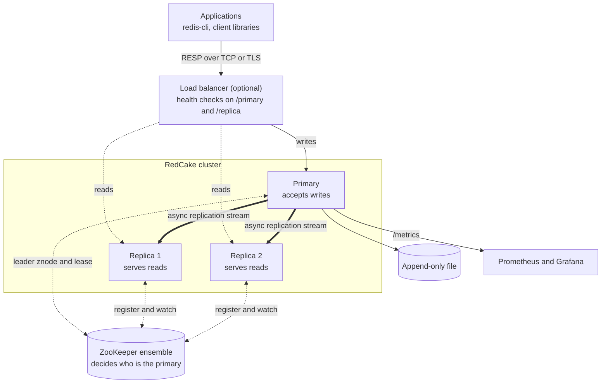

### 4.2 Inside one node

One JVM, one Spring context. The layers below are Spring beans; arrows show the direction of a request.

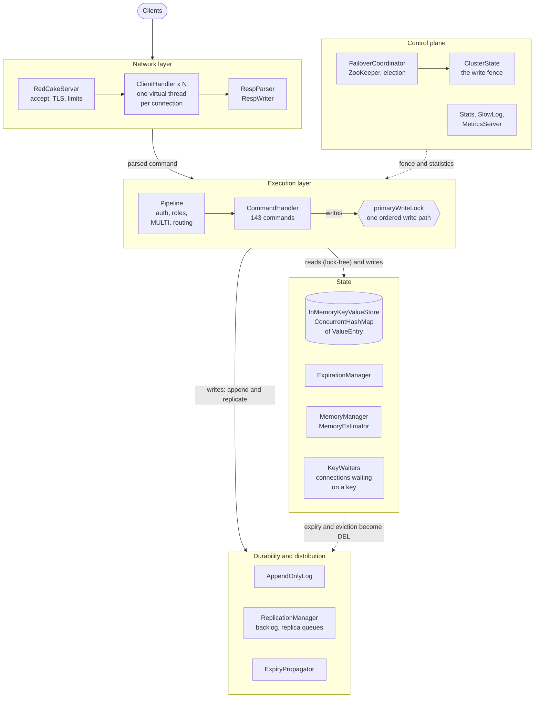

| Package | Responsibility |
|---|---|
| `cli`, `config` | strict argument and config-file parsing; immutable config objects (a few can change at runtime with `CONFIG SET`) |
| `server` | `RedCakeServer` (listener, TLS, limits, protected mode), `ClientHandler` (per-connection pipeline), `Session`, `ClientRegistry`, `AuthFailureTracker` |
| `resp` | `RespParser` (incremental, bounded), `RespWriter`, reply value types |
| `command` | `CommandHandler` router, `RedCakeCommand` / `LambdaCommand` / `CommandProvider`, the hooks `PreparedWork` (work before the lock), `BlockingRequest` (a command that waits) and `Propagation` (a command that logs what it did), and `commands/{reads,write,types}` |
| `store` | `InMemoryKeyValueStore`, `ValueEntry`, `ExpirationManager`, `MemoryManager` / `MemoryEstimator`, `ZSet`, `SnapshotEntry`, `KeyWaiters`, `GlobMatcher` |
| `vector` | `VectorSet` (HNSW index), `Quantization`, `DistanceKernel` with `ScalarKernel` / `SimdKernel`, `SearchContext`, `LongHeap` |
| `json` | `JsonDocument` (every operation on a document), `JsonObject`, `JsonArray` (unboxed number arrays), `JsonParser`, `JsonWriter`, `JsonPath` (JSONPath with filters), `KeyPool` |
| `stream` | `Stream` (the value: entries plus consumer groups), `EntryLog` (blocks of packed entries), `StreamId`, `ConsumerGroup`, `Consumer`, `Pending` |
| `persistence` | `AppendOnlyLog`, `ExpiryPropagator` |
| `replication` | primary side (`ReplicationManager`, `ReplicaConnection`, `ReplicationBacklog`) and replica side (`ReplicaSyncManager`) |
| `cluster` | `FailoverCoordinator`, `ZooKeeperService` (Curator), `ElectionPolicy`, `ClusterState`, znode record codecs |
| `security` | `AclRegistry`, `Role`, `TlsSupport` |
| `pubsub`, `stats`, `metrics` | broker, counters / slow log / replication stats, Prometheus and health endpoint |

### 4.3 Threads

There is no event loop. Blocking I/O is cheap on virtual threads, so each connection simply gets its own.

| Thread | Kind | Job |
|---|---|---|
| `RedCakeAcceptThread` | platform | accepts sockets, enforces `--max-clients` (a semaphore), hands each socket to a virtual thread |
| one per client connection | **virtual** | TLS handshake (when enabled, so a stalled handshake cannot block the accept loop), reads requests, runs the pipeline, writes replies; blocks freely - a connection waiting in `XREAD BLOCK` is simply parked here, holding no lock ([4.13](#413-streams-and-consumer-groups)) |
| `RedCake-ExpirationThread` | platform, daemon | sleeps until the earliest TTL deadline and expires the key |
| `RedCake-AofFsync` | platform | fsync once per second with `--aof-fsync everysec` |
| `RedCake-ReplicationHeartbeat` | platform | `PING` to replicas every 10 s |
| `RedCake-ReplicaWriter-<id>` | **virtual**, one per replica | drains that replica's queue into its socket |
| `RedCakeReplicaSync`, `RedCakeReplicaAck` | **virtual** | replica side: connect, sync, apply the stream; acknowledge the offset every second |
| `RedCake-Cluster`, `RedCake-ClusterLease` | platform, daemon | failover only: reconcile loop (every tick and on every watch event), lease renewal |
| Curator / ZooKeeper client threads | platform | session, watches, reconnects |
| metrics HTTP server | platform dispatcher + virtual workers | `/metrics`, `/health`, `/primary`, `/replica` |

### 4.4 Life of a command

**Parsing.** `RespParser` reads RESP arrays or inline commands incrementally and enforces bounds (1,024 arguments, 1 MiB per
bulk string, 8 MiB per command) so a hostile client cannot make the server allocate without limit. Replies are flushed only
when no further request bytes are waiting, so a pipelining client gets one syscall per batch instead of per command (about
20x throughput at `-P 16`, see [section 8](#8-performance)).

**The pipeline.** Every command passes the same checks in the same order:

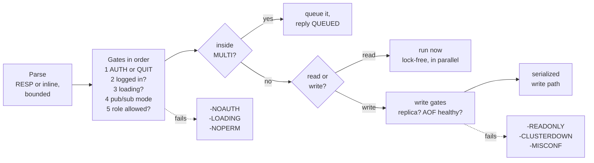

**The write path.** This is the heart of the design (ADR 0001). The lock covers in-memory work only:

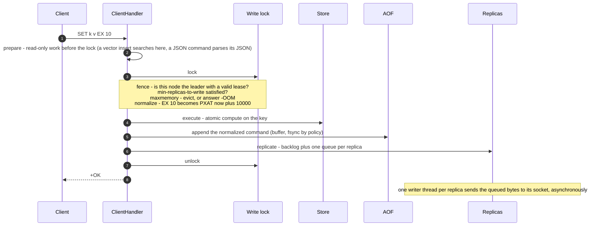

What the lock buys: the AOF, the backlog and every replica see **exactly the primary's order**; a snapshot taken under it is
point-in-time; `EXEC` can hold it for a whole batch so the commands are contiguous in the log. What it costs: write
throughput is bounded by one core of "execute + encode" (measured well above 100k writes/s pipelined, section 8). The store
itself is safe without the lock (`ConcurrentHashMap.compute`), so reads, the expiry thread and Pub/Sub never wait for it.

**Two kinds of command do not fit "run, log, replicate", and each has a hook.** A command that has to *wait* - `XREAD ... BLOCK` -
is run by `ClientHandler.blockingExecute`: when it finds nothing it parks the connection's virtual thread **outside every lock**
until a key it waits on changes ([4.13](#413-streams-and-consumer-groups)). A command whose effect cannot be replayed from its own
arguments - `XREADGROUP`, which hands out whatever is new *now* - tells the server what it did (`Propagation`), and that is what is
logged and replicated instead of the command.

**Follow one write through the code**

```text
RedCakeServer.acceptClients            accept, --max-clients semaphore, hand the socket to a virtual thread
└─ ClientHandler.handleClient          session, 15 s authentication deadline
   └─ serve                            parse loop; flush replies when no more request bytes are waiting
      └─ process                       the gates: AUTH, LOADING, pub/sub mode, role check, MULTI
         └─ dispatch, timedExecute     command statistics, SLOWLOG, MONITOR feed
            (blockingExecute             a command that waits parks here, outside the lock)
            └─ execute                 read: CommandHandler.handle. write: replica? AOF healthy?
               └─ executeWrite         prepare, then under ReplicationManager.lockPrimaryWrites:
                                         ClusterState.mayWrite, hasEnoughReplicasToWrite,
                                         MemoryManager.makeRoom, CommandHandler.normalize,
                                         CommandHandler.handle  ->  the command  ->  store compute section,
                                         propagate (the normalized command, or what the command says it did)
                                         ->  AppendOnlyLog.append + ReplicationManager.replicate
```

**Transactions.** `MULTI` queues commands on the session. `EXEC` first refuses the whole batch if it contains a write and the
node may not write (all or nothing), then takes the write lock, verifies every `WATCH`ed key still has the version seen
at `WATCH` time (otherwise returns a null array), and runs the queued commands back to back. As in Redis, a command that fails at run
time does not undo the ones before it.

**Errors clients can see**

| Reply | Meaning |
|---|---|
| `-NOAUTH`, `-WRONGPASS` | authenticate first / bad credentials or locked out |
| `-NOPERM` | the user's role may not run this command |
| `-READONLY` | write sent to a replica; the message names the primary when known |
| `-CLUSTERDOWN` | no writable primary right now (election, ZooKeeper unreachable, hand-over); retry |
| `-NOREPLICAS` | `--min-replicas-to-write` is not satisfied |
| `-LOADING` | node is syncing from a primary or joining a cluster; retry |
| `-MISCONF` | the append-only file cannot be written; writes are refused instead of pretending |
| `-OOM` | `--maxmemory` reached under `noeviction` |
| `-WRONGTYPE` | the key holds another kind of value |
| `-EXECABORT` | transaction discarded (earlier queueing error, or the node may not write) |
| `-NOPROTO` | `HELLO 3`: only RESP2 is spoken |
| `-NOTPRIMARY` | `PSYNC` sent to a node that is not (yet) the primary |

### 4.5 Data model

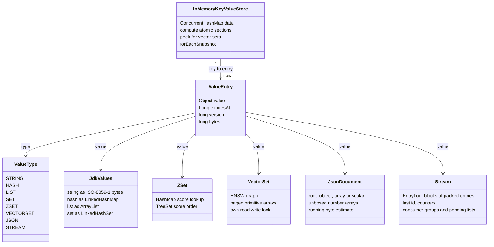

| Type | Java representation | Notes |
|---|---|---|
| string | `String` holding **ISO-8859-1 bytes** | lossless for any binary data, one byte per char in memory (ADR 0003) |
| hash | `LinkedHashMap` | insertion order |
| list | `ArrayList` | `LPUSH` / `LPOP` are O(n) |
| set | `LinkedHashSet` | `SPOP` / `SRANDMEMBER` are not offered: they are non-deterministic and would make replicas diverge |
| sorted set | `ZSet` = `HashMap` + `TreeSet` | O(1) score lookup, O(log n) insert, `ZRANK` is O(n) |
| vector set | `VectorSet` | see [4.11](#411-vector-search) |
| JSON document | `JsonDocument` (`TYPE` says `ReJSON-RL`) | see [4.12](#412-json-documents) |
| stream | `Stream`: an `EntryLog` of blocks of packed entries, plus consumer groups | see [4.13](#413-streams-and-consumer-groups) |

- **Atomicity.** Every mutation runs inside `ConcurrentHashMap.compute*`, i.e. under that key's bin lock, and replaces the
  `ValueEntry` with a new `version`. `WATCH`, expiry events and snapshots detect changes by comparing versions (ADR 0004).
- **Collections vanish when empty** (a stream does not: it keeps its last id and its groups) and wrong-type access throws `WRONGTYPE`.
- **`bytes`** is the entry's estimated size, kept with the entry so `used_memory` is an O(1) running total.
- **Why `String` for bytes?** Decoding bulk strings as UTF-8 would silently corrupt binary data. ISO-8859-1 maps every byte
  0-255 to one char, so the whole code base keeps `String` and stays binary-safe; `STRLEN` equals the byte length.

### 4.6 Expiration

Keys expire in two ways, and both end in the same place:

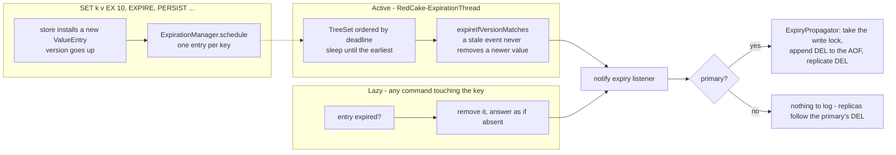

- **One schedule entry per key.** Re-scheduling replaces the old entry, so the schedule grows with the number of keys that
  *currently* have a TTL, not with the number of writes (an earlier priority-queue design leaked here).
- **Absolute deadlines, explicit `DEL`s.** Every node hides and removes a key when its own clock passes the key's absolute deadline
  (`PXAT`, identical everywhere). Only the primary also records the removal as a `DEL` in the AOF and the stream, so a replica that
  lags converges on the primary's sequence of events, and an AOF replay reproduces removals in the order they happened instead of
  depending on when it runs.
- Memory-pressure evictions follow the same rule: the evicted key is logged and replicated as a `DEL`.

### 4.7 Persistence (AOF)

`--aof-file data/redcake.aof` logs every successful write as RESP, **after normalization** (absolute times, canonical
vectors), so replaying the file always reproduces the same dataset.

```mermaid
flowchart TB
    subgraph rw["BGREWRITEAOF - compaction"]
        r1["take the write lock"] --> r2["write the commands of every key<br/>to a temp file<br/>(vector sets as VRESTORE dumps,<br/>a large JSON document in pieces,<br/>a stream as XADD, XSETID, XGROUP, XRESTORE)"]
        r2 --> r3["fsync, then atomic<br/>rename over the AOF"]
        r3 --> r4["release the lock,<br/>keep appending"]
    end
    subgraph start["Startup"]
        s1["read the file"] --> s2["replay each command through<br/>the normal executor<br/>(no logging or replication)"]
        s2 --> s3{"torn tail<br/>from a crash?"}
        s3 -->|yes| s4["truncate to the last<br/>complete command"]
        s3 -->|no| s5["ready to serve"]
        s4 --> s5
    end
    subgraph app["Appending - every write, under the write lock"]
        w1["normalized command"] --> w2["encode as RESP<br/>into the buffer"]
        w2 --> w3{"--aof-fsync"}
        w3 -->|always| w4["fsync before the reply<br/>durable, adds latency"]
        w3 -->|"everysec (default)"| w5["fsync thread syncs<br/>once a second"]
        w3 -->|no| w6["left to the<br/>operating system"]
    end
```

- **If a disk write fails**, the node answers writes with `-MISCONF` and `/health` returns 503: it does not pretend data is
  safe. (The change already happened in memory and is still replicated.)
- **Only primaries log.** A replica holds the dataset in memory and mirrors the stream; a promoted replica starts its AOF from
  its in-memory dataset.
- **Crash test.** `scripts/crash-test.sh` kills the server with `kill -9` under load and checks that, with `--aof-fsync always`,
  no acknowledged write is lost.
- `BGREWRITEAOF` currently runs synchronously under the write lock (writers pause for the duration; O(keys)).

### 4.8 Memory limit

`--maxmemory SIZE` turns on accounting. `MemoryEstimator` computes a deliberately generous, approximate size per entry
(strings by length, collections by element count, vector sets from their allocated pages, JSON documents and streams from running totals
kept up to date by every change) and the store keeps a running total.
Before every growing write, inside the write lock, `MemoryManager.makeRoom` applies the policy:

| Policy | When over the limit |
|---|---|
| `noeviction` (default) | growing commands get `-OOM`; reads, deletes and `EXPIRE` still work |
| `allkeys-random` | evicts arbitrary keys until the write fits |
| `volatile-ttl` | evicts the keys closest to expiry first |

Evictions are logged and replicated as `DEL`. Keep `--maxmemory` comfortably below the JVM heap: the figure is an estimate, and
snapshots (full sync, AOF rewrite, vector dumps) briefly hold copies.

### 4.9 Replication

Asynchronous primary to replica (ADR 0002). Everything is RESP arrays; the dataset copy is a stream of ordinary commands, not
an RDB file, which keeps the protocol small at the price of working only between RedCake nodes.

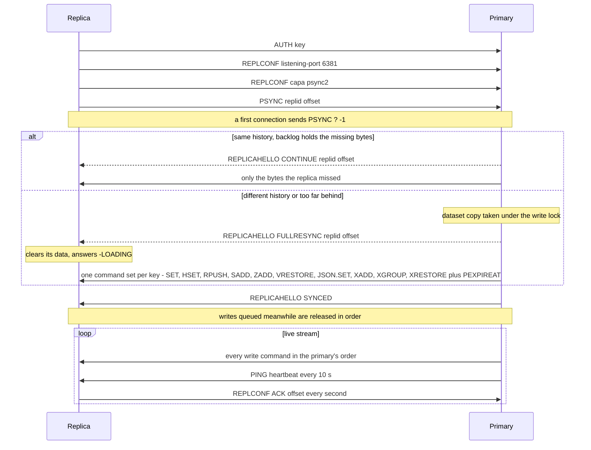

**Offsets and history.** `replid` names a replication history (created at boot, and again on promotion); `offset` counts bytes
of the canonical RESP stream. Snapshot commands do not advance it, so a caught-up replica has the same offset as its primary.

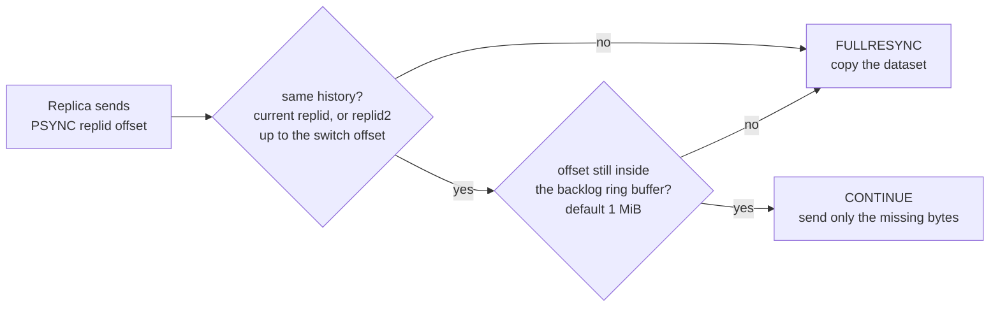

- **Backlog.** A ring buffer of the most recent stream bytes. A short disconnect costs the missing bytes, not a dataset copy.
- **Slow replica protection.** Each replica has a queue capped at 64 MiB; beyond that it is dropped (and will resync) instead of
  growing the primary's heap. A silent link times out after 60 s without bytes; the replica reconnects with exponential backoff
  (1 s to 30 s).
- **`WAIT n ms`.** Appends a `REPLCONF GETACK *` marker to the stream and blocks until `n` replicas acknowledged the resulting
  offset, which bounds how much an unplanned failover could lose.
- **`--min-replicas-to-write N` / `--min-replicas-max-lag S`.** The primary refuses writes (`-NOREPLICAS`) unless `N` replicas
  acknowledged within `S` seconds.
- **Roles at run time.** `REPLICAOF host port` turns a node into a replica of that primary (a full sync replaces its data),
  `REPLICAOF NO ONE` promotes it with a new history. After a promotion the old id stays valid up to the switch offset
  (`replid2`, Redis "PSYNC2"), and every replica mirrors the stream it applies into its own backlog, so the *other* replicas
  resume from the new primary without copying the dataset.
- **Not replicated:** Pub/Sub messages (a stream is replicated and persisted; use one when messages must survive). Chaining (a
  replica of a replica) is not supported.

### 4.10 High availability (automatic failover)

Opt-in: give every node the same `--zk-connect` and they elect a primary, and elect a new one when it fails. No `--replicaof`,
no manual `REPLICAOF NO ONE`. Full design and safety argument: [ADR 0005](docs/adr/0005-zookeeper-failover.md); step-by-step
operation guide: [`docs/running-with-zookeeper.md`](docs/running-with-zookeeper.md).

```bash
# three nodes on three hosts, one ZooKeeper ensemble (the same options everywhere except --advertise-host)
export REDCAKE_API_KEY=change-me
java -jar redCake.jar --bind 0.0.0.0 --aof-file data/redcake.aof \
     --zk-connect zk1:2181,zk2:2181,zk3:2181 --advertise-host node1
redis-cli -h node1 INFO cluster          # cluster_state:leading | following | electing
redis-cli -h node1 FAILOVER              # planned: hand the primary role to the best replica, no write lost
```

**ZooKeeper is the single source of truth for who the primary is.** Each node is a Curator client; roles are *derived* by one
reconcile loop that re-reads the state every tick and on every watch event, so a lost or reordered notification cannot matter.

```text
/redcake/<cluster-name>/
├── epoch            persistent   highest leader epoch ever granted (changed only by compare-and-set)
├── leader           EPHEMERAL    the primary: node id, address, epoch. Exists exactly as long as its owner's session
├── nodes/
│   ├── node1        EPHEMERAL    role, replid, offset, data epoch, priority, key count, "loading"
│   ├── node2        EPHEMERAL
│   └── node3        EPHEMERAL
└── failover         EPHEMERAL    optional hint of a planned hand-over: "give it to X"
```

**Node states.** `LEADING` splits in two: a leader that cannot prove its leadership is *fenced* and refuses writes.

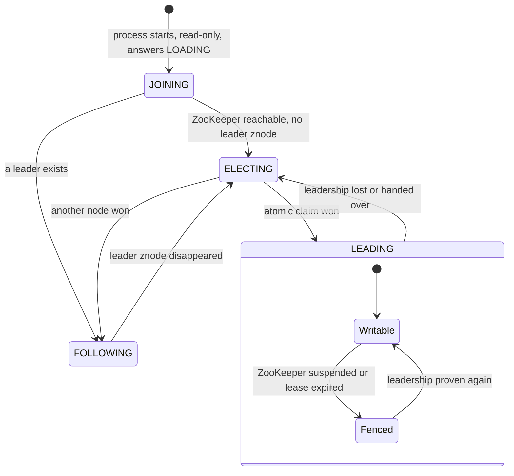

**Election.** When `/leader` is absent every node waits a *settle period* (`--cluster-election-delay-ms`, so all publish their
final offset), then `ElectionPolicy` ranks the registered nodes and the node of rank *r* tries to claim leadership *r* delays
later. The claim is **one ZooKeeper multi-transaction**: "set `/epoch` to N+1 *if its version is still the one I read* **and**
create `/leader`". ZooKeeper applies it atomically in one global order, so of any number of simultaneous claimants exactly one wins
and every epoch number is issued once. The ranking only decides who is *tried first*; correctness never depends on it.

Ranking: operator's hand-over target, lowest `--replica-priority` number (`0` = never), newest data lineage, **highest replication
offset** (least data lost), most keys, node id. A node whose data came only from an old AOF (older than the last leader's epoch) can
never lead, so a stale file cannot take over a cluster that has moved on.

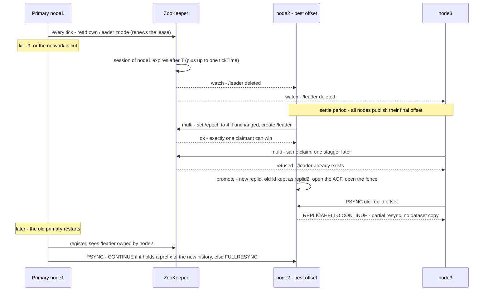

**Fencing: never two writers.** A write is accepted only if `ClusterState.mayWrite()` holds, checked **inside the write lock for
every write** (and before an `EXEC` that contains writes): the node is the leader, its ZooKeeper connection is `CONNECTED`
(`SUSPENDED` or `LOST` fences immediately), and its **lease** has not expired. The lease is renewed by a successful read of its own
`/leader` znode and lasts **2/3 of the session timeout T**, measured from when the read *started*:

```text
          ZooKeeper session timeout T  (default 10 s)
 ◀──────────────────────────────────────────────────────────────────▶
 t0                                    t0 + 2T/3                      t0 + T
 │ last proof: the primary read        │ lease over: writes answer    │ earliest instant ZooKeeper may
 │ its own /leader znode, which also   │ -CLUSTERDOWN and the node    │ delete /leader and let another
 │ refreshed its session               │ steps down                   │ node be elected
 ├──────────── writes accepted ────────┼── fenced, safety margin T/3 ─┤
```

When the read succeeded, ZooKeeper had just refreshed the session, so the session cannot expire before `t0 + T`. The primary
stops at `t0 + 2T/3`, at least `T/3` *before* anybody else can be elected. A primary that is cut off, or frozen by a long GC or VM
pause, therefore stops by itself, and on waking up its first write sees an expired lease (`nanoTime` is monotonic; clocks need to
agree on *rate*, not on time). A fenced primary also refuses `PSYNC`.

**Planned hand-over** (`FAILOVER [TO host port] [TIMEOUT ms]`, or `SIGTERM` / `SHUTDOWN` on the primary): pause writes, wait until
the replicas (or the named target) acknowledged everything, write a `/failover` hint, release `/leader`. No timeout is awaited and
no write is lost; if the replicas do not catch up in time a named `FAILOVER` changes nothing. The old primary then follows the new
one with a partial resync.

**What happens when...** (all covered by `ClusterFailoverTest`, which runs real nodes against an embedded ZooKeeper)

| Situation | Behaviour |
|---|---|
| Cluster starts for the first time | nodes register; the best candidate claims epoch 1, the rest follow |
| Primary process killed / machine lost | session expires; best replica promoted; the others resume with a partial resync |
| Primary cut off from ZooKeeper but running | fences at once (`-CLUSTERDOWN`), demotes itself after T, becomes a replica on reconnect; unreplicated writes are discarded |
| Frozen process (GC, VM pause, `SIGSTOP`) | no event arrives; the lease runs out first; same outcome |
| ZooKeeper blip shorter than the session | primary fenced briefly, proves itself again, resumes; no election |
| ZooKeeper down longer than the session | every node loses its znodes; on return a new election, data intact, no full resyncs |
| Several nodes want to lead | the atomic claim lets exactly one win |
| Best candidate dies right after the leader | the next rank claims one stagger later |
| Only stale / empty / `priority 0` nodes left | no election; writes `-CLUSTERDOWN`; reads continue; `INFO cluster` says why |
| Primary has too few replicas | `--min-replicas-to-write` refuses writes with `-NOREPLICAS` |

**Timing** (T = `--zk-session-timeout-ms`, default 10 s). Failure is detected between T and T + one ZooKeeper `tickTime` after the
last heartbeat; add the settle period and staggering. Measured: about **12-14 s** from `kill -9` to a writable successor with the
defaults (ZooKeeper's default 2 s tick), 5.1 s with a 3 s session and a 1 s tick, and **0.25-0.45 s** for a planned hand-over.
Shorter sessions are faster but turn network blips into elections (the ZooKeeper client waits before every reconnect: 0.2-1.1 s
with several servers in `--zk-connect`, 1.2-1.7 s with one). **List every ensemble member and keep T at 5 s or more** unless you
have measured your network.

**What clients see.** `ROLE`, `INFO cluster` (`cluster_state`, `cluster_leader`, `cluster_epoch`, `cluster_fenced`,
`cluster_zk_state`, `cluster_election` = why an election is stuck) and the `-READONLY ... (the primary is host:port)` hint tell a
client where to write. Behind a load balancer nothing changes for clients: `GET /primary` on the metrics port is `200` only on the node
that may write, `GET /replica` is `200` on replicas that hold trusted data (`deploy/haproxy.cfg.example`).

**Security of the control plane.** Anyone who can write the znodes can choose the primary (and so receive the replication `AUTH`).
Use `REDCAKE_ZK_AUTH` / `--zk-auth-file` (digest ACLs; nodes warn at startup if missing) and `--tls-replication`, which makes
replicas verify the primary's certificate, so a tampered znode alone cannot capture the API key.

**If an election is stuck** (`cluster_election:` says "its data (epoch 3) is older than the last leader's epoch 5"): bring back the
node with the newest data. If it is gone for good and you accept the loss, set the znode `/redcake/<cluster>/epoch` to `0` with
`zkCli`. This is deliberately a manual, visible act.

### 4.11 Vector search

Vector sets store embeddings next to their keys and answer "which stored vectors are most similar to this one?" with an HNSW
index. The command family follows Redis 8 (`VADD VSIM VREM VCARD VDIM VEMB VINFO VGETATTR VSETATTR VISMEMBER VRANDMEMBER VLINKS`), the
key's type is `vectorset`, and everything else (AOF, replication, failover, `maxmemory`, `WATCH`, ACL roles, `WRONGTYPE`) works
as for any other type. Design record and measurements: [ADR 0006](docs/adr/0006-vector-search.md).

```bash
# "..." stands for the remaining numbers; FP32 takes a little-endian float32 blob instead of VALUES
VADD movies VALUES 384 0.12 -0.03 ... alien SETATTR '{"year":1979}'
VSIM movies ELE alien WITHSCORES WITHATTRIBS COUNT 10         # nearest to a stored element
VSIM movies FP32 <blob> COUNT 5 EF 200                         # nearest to a query vector; bigger EF = better recall
VSIM movies ELE alien COUNT 10 TRUTH                           # exact scan when the answer must be exact
```

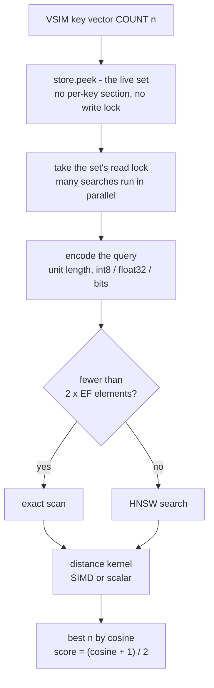

**Index.** A Hierarchical Navigable Small World graph: sub-linear queries (cost grows with the exploration factor `EF`, not with
the number of elements), high recall, one-element-at-a-time inserts and deletes with no training step. Defaults: `M 16` links,
build `EF 200`, search `EF 100`.

```text
 layer 2   o──────────────────────────────o                      few nodes, long jumps
           ╎                              ╎
 layer 1   o────────o──────────o──────────o────────o             about 1/M of the nodes
           ╎        ╎          ╎          ╎        ╎
 layer 0   o──o──o──o──o──o──o──o──o──o──o──o──o──o──o──o──o     every node, up to 2M links each

 query: enter at the top, hop greedily towards the query vector, drop a layer, repeat;
        on layer 0 run a best-first search that keeps EF candidates, return the best COUNT.
```

Two choices make deletes exact and cheap, which most HNSW implementations do not offer:

- **Reciprocal links** (a links to b exactly when b links to a): removing an element knows everyone that points at it, unlinks it,
  reconnects its neighbours to each other (most similar pairs first) and frees the slot for reuse. No tombstones, no periodic
  rebuild, memory does not grow with churn.
- **The level of an element comes from a hash of its name**, not from a random generator, so the same commands build the same graph
  on the primary, on a replica and when the AOF is replayed.

**Storage.** Every vector is normalized to unit length (similarity is the cosine) and stored as:

| Option | Per dimension | Trade-off |
|---|---|---|
| `Q8` (default) | 1 byte + one scale per vector | a quarter of float32 for about 1.6 % lower recall (0.984 against exact float32 at `EF 100`) |
| `NOQUANT` | 4 bytes (float32) | exact |
| `BIN` | 1 bit, compared by Hamming distance | 32x smaller and faster, coarse: keeps clusters together but cannot rank neighbours inside a tight cluster |

**Memory layout.** No object per element and none per link: slots live in a few primitive arrays cut into pages of about 256 KB
that are added as the set grows and never copied. The garbage collector sees tens of large arrays instead of millions of small
objects.

```text
 VectorSet "movies"  (384 dimensions, Q8, M 16)
 ├─ pages 0, 1, 2 ...        about 256 KB each, allocated on demand, never copied
 │    per slot (one per element)
 │      codes   byte[384]    the int8 vector
 │      scale   float        one scale per vector, so int-dot * scale * scale IS the cosine
 │      level   byte         hash-derived top layer of the element
 │      links0  int[2M + 1]  layer-0 neighbours: a count and up to 32 ids      (132 bytes)
 │      name    offset/len   into the name pages
 ├─ upper layers             sparse link arrays, only about 1/M of the elements get here
 ├─ name index               open-addressing int table, element name to slot
 └─ attributes               optional JSON text per element (stored and returned, not yet filterable)

 measured: 639 bytes per 384-dimensional vector, name and links included   (float32 alone: 1,536)
```

**Distance kernels.** The hot loop is the dot product. Two interchangeable kernels: a portable pure-Java **scalar** one, and a
**SIMD** one on the JDK's incubating Vector API, chosen automatically when the JVM was started with
`--add-modules jdk.incubator.vector` (`-Dredcake.vector.kernel=auto|scalar|simd`; `simd` fails at startup if unavailable). The int8
sums are exact integers, so **both kernels produce identical scores and identical graphs on int8 data**. The SIMD class is created
by reflection, so `java -jar redcake.jar` works everywhere and logs which kernel it picked.

**Searches do not wait for the write lock; inserts do their expensive half before taking it.** Finding the neighbours of a new
vector is a read-only graph search (about 90 % of an insert, measured 540 us against 53 us); only wiring the node in changes links.
`ClientHandler` therefore calls `RedCakeCommand.prepare` on the connection's own thread *before* the server write lock, so
connections do the search in parallel, and only the wiring runs inside the lock:

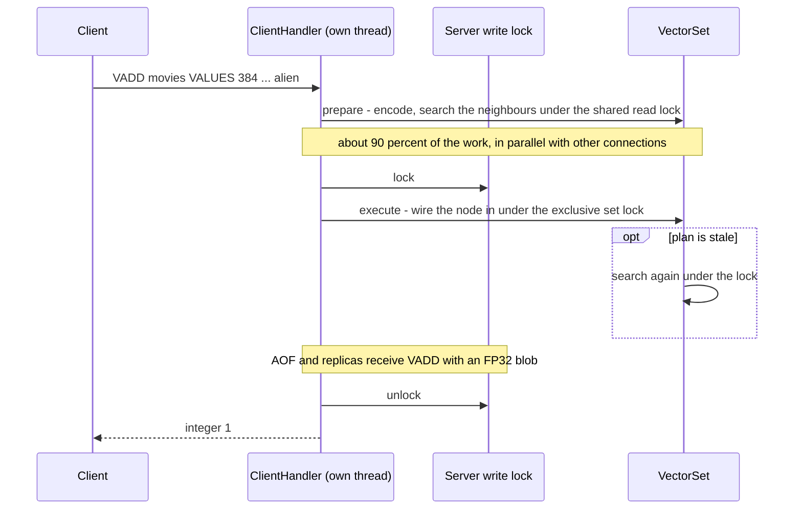

A plan stays valid while other elements are merely *inserted* (they are just not among the neighbours, as in any parallel HNSW
build) and is discarded when something was *removed*. Commands that skip the prepare step (a replica applying the stream, AOF replay)
search under the lock; the result is the same. Lock order is always: server write lock, store key section, set lock.

**Persistence and replication of a graph.** The AOF and the stream carry `VADD` with the vector rewritten to an `FP32` blob, so
every node reads identical bits. A *snapshot* (AOF rewrite, full sync, promotion) must not re-insert a million vectors (that takes
the better part of an hour), so it is a compact binary **dump of the graph**:

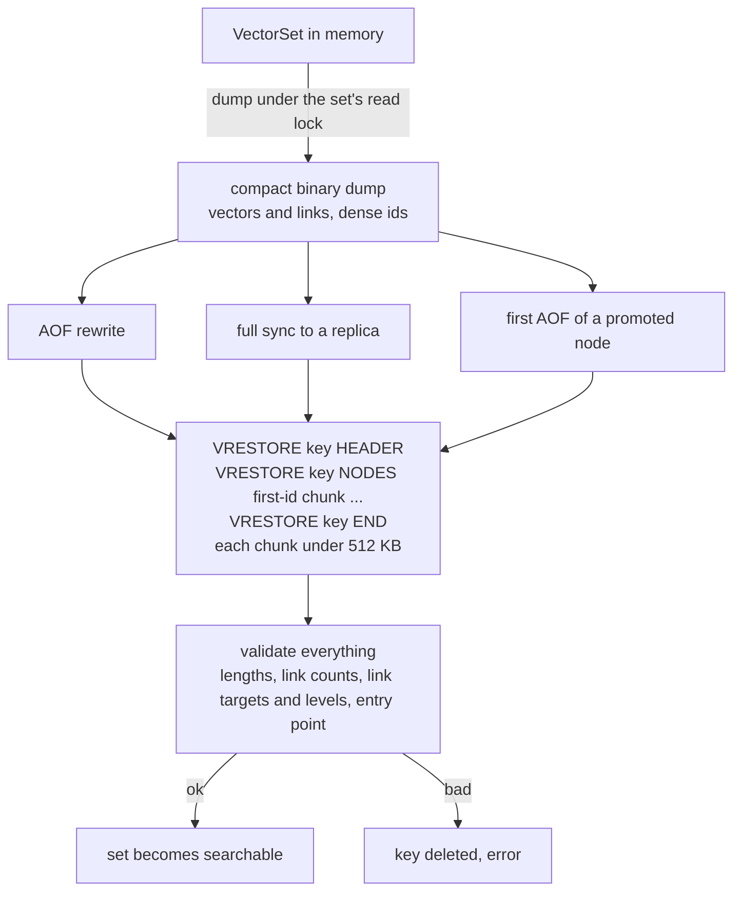

Loading 21,000 vectors took 0.07 s against 17 s (SIMD) or 52 s (scalar) to insert them again. `VRESTORE` is administrative (admin role)
and a test flips random bits in dumps to check that nothing crashes. A set refuses searches until `END` has validated it.
The elements, vectors and attributes of a replica always equal the primary's; the **graph** is equivalent but not always identical
(an insert that used a plan made before another connection's insert is wired a little differently from a replica that searched
under the lock), so results can differ in rare near-ties.

**Limits** (they bound what one command can ask for): dimension 1-16,384 (`VALUES` also needs the command under 1,024 arguments:
use `FP32` above about 1,000), `EF` and `COUNT` at most 10,000, `M` 4-128, element name 64 KB, attribute 256 KB.

**Measured** (20,000 vectors x 384 dimensions, clustered, `Q8`, `M 16`, `EF 100`, `COUNT 10`; laptop with 2 cores / 4 threads, **shared
with a browser and an IDE**, so values wobble by 2x; median of 3 alternating runs; reproduce with `scripts/vector-benchmark.sh`):

| | SIMD kernel | scalar kernel |
|---|---|---|
| insert, one thread | 1,150 / s | 390 / s |
| search latency p50 / p99 | 0.32 ms / 1.0 ms | 0.72 ms / 3.0 ms |
| searches per second, 1 / 2 / 4 threads | 2,950 / 4,000 / 5,400 | 1,230 / 2,000 / 2,200 |
| recall@10 against an exhaustive scan of the same codes | 1.000 | 1.000 |
| recall@10 against exact float32 cosine | 0.984 | 0.984 |
| memory per vector | 639 bytes | 639 bytes |

Over TCP (15,000 x 384): `VSIM` 1,360/s from one client and 6,900/s from eight; an ordinary `SET` had a **p50 of 38 us while another
client streamed about 860 `VADD` per second, against 34 us on an idle server**. Differences from Redis 8: `REDUCE` and `FILTER`
answer with an error; `CAS` and `NOTHREAD` are accepted and ignored. The semantics were written from Redis's documentation and
**not checked against a Redis 8 server**, so treat byte-for-byte compatibility as unverified.

### 4.12 JSON documents

A record in a machine-learning application is a text, an embedding, metadata and a status. As a hash it is flat; as a
string it is read, changed and written back whole; as several keys it cannot be updated atomically. A **JSON document** is
one key that holds the whole record and is read and changed **by path**: `JSON.SET doc:1 $.status '"done"'` changes one
field, atomically, without moving the embedding, and is logged and replicated as exactly that command. The command family
is RedisJSON's (`JSON.SET GET MGET DEL FORGET TYPE NUMINCRBY NUMMULTBY STRAPPEND STRLEN ARRAPPEND ARRINSERT ARRINDEX ARRLEN
ARRPOP ARRTRIM OBJKEYS OBJLEN TOGGLE CLEAR MERGE DEBUG`), the type is reported as `ReJSON-RL`, and the client libraries that
know it work unchanged (checked with `redis-py`'s `r.json()`). Design record and measurements:
[ADR 0007](docs/adr/0007-json-documents.md).

```bash
JSON.SET doc:1 $ '{"id":"doc-1","text":"...","embedding":[0.12,-0.03,0.88],"meta":{"source":"web","tags":["a"]},"status":"new","attempts":0}'
JSON.SET doc:1 $.status '"processing"'                       # change one field; nothing else moves
JSON.NUMINCRBY doc:1 $.attempts 1                            # an atomic counter inside the record
JSON.ARRAPPEND doc:1 $.meta.tags '"b"'                       # grow an array
JSON.MERGE doc:1 $ '{"status":"done","meta":{"source":null}}'   # RFC 7386: null deletes
JSON.GET doc:1 $.status $.meta.tags                          # several paths: {"$.status":["done"],"$.meta.tags":[["a","b"]]}
JSON.GET doc:1 INDENT "  " NEWLINE "\n" SPACE " "           # formatted
JSON.MGET doc:1 doc:2 doc:3 $.status                         # the same path in several documents (nil where there is none)
```

```text
$ redis-cli JSON.SET cart '$' '{"items":[{"sku":"a","price":5},{"sku":"b","price":15}],"owner":{"name":"Nitesh"}}'
OK
$ redis-cli JSON.GET cart INDENT '  ' NEWLINE $'\n' SPACE ' ' .
{
  "items": [
    {
      "sku": "a",
      "price": 5
    },
    {
      "sku": "b",
      "price": 15
    }
  ],
  "owner": {
    "name": "Nitesh"
  }
}
$ redis-cli JSON.GET cart '$..price'
[5,15]
```

```python
import redis                                                  # redis-py: RedCake speaks RESP2, so ask for it
r = redis.Redis(port=6379, protocol=2, decode_responses=True)
r.json().set("doc:1", "$", {"text": "hello", "embedding": [0.1, 0.25], "status": "new"})
r.json().set("doc:1", "$.status", "done")
r.json().get("doc:1", "$.status")                             # ['done']
```

**What a record looks like in memory.** The aim is that a record costs about its own size, not twice it:

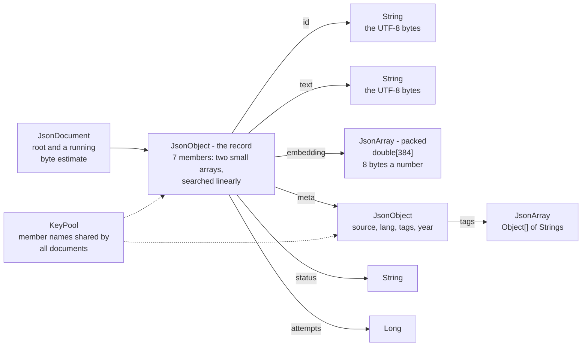

- **Byte-exact text.** Strings are the UTF-8 bytes the client sent (ADR 0003); nothing is decoded and encoded again, so a
  document comes back byte for byte. The parser validates UTF-8 and `\u` escapes, so everything stored is valid JSON for any
  other reader. Lengths are in bytes.
- **Numbers keep their type.** `1` is an integer and comes back as `1`; `1.0` is a double. An integer outside 64 bits becomes a
  double (RedisJSON keeps unsigned values up to 2^64-1).
- **Unboxed number arrays.** An embedding is hundreds of numbers: as `Object[]` of `Double` about 20 bytes each, as a
  `double[]` 8. An array of only integers is a `long[]`, of only fractions a `double[]`; the first value that does not fit
  turns it into an `Object[]`, invisibly.
- **Small objects are two arrays**, objects with more than 16 members a `LinkedHashMap`; member names are shared between
  documents. Together with the unboxed arrays a 6.7 KB record takes **6.3 KB on the heap, half of what maps and boxed
  numbers need**.
- **Insertion order is kept**; replacing a member keeps its place.

**Paths.** Two dialects, as in RedisJSON. A **JSONPath** starts with `$` and may select any number of values; replies are
arrays with one entry per match. A **legacy** path (`.a.b[0]`, or just `a.b`) selects one value; replies are that value and a
missing one is an error. A command that leaves the path out means the legacy root `.`, so `JSON.GET doc:1` answers with the
document itself.

| Syntax | Selects |
|---|---|
| `$`, `.` | the whole document |
| `$.a.b`, `$['a b']`, `$["a.b"]` | a member (quotes and JSON escapes for unusual names) |
| `$.items[0]`, `$.items[-1]` | an element, counted from the start or the end |
| `$.items[*]`, `$.a.*` | every element or member |
| `$..price` | `price` at any depth (recursive descent); `$..*` every value below |
| `$.items[1:3]`, `$.items[::2]`, `$.items[::-1]` | a slice with an optional step |
| `$['a','b']`, `$.items[0,2]` | several members or elements |
| `$.items[?(@.price < 10 && @.status == "ok")]` | the elements for which the filter holds: `== != < <= > >=`, `&& \|\| !`, `@` (the candidate), `$` (the root), literals, a bare path as an existence test |

A path is client input, so it is bounded: 8,192 bytes, 32 levels of nested filters, and **one budget of 10 million node visits
per evaluation, shared by nested filters** - `$..*..*..*..*..*..*` and `$..[?($..[?($..*)])]` are abandoned with an error
instead of holding a thread and the key's lock. Checked against a reference implementation (Jayway JsonPath) on more than
5,000 random paths for the syntax both implement.

**Changing a document: validate, then apply.** The server logs and replicates only commands that succeeded, so a command that
fails *after* changing something would make the primary differ from its log and from its replicas. Every operation therefore
checks what can fail (index ranges, nesting depth, results that are not finite numbers) before it changes anything: **an
error leaves no trace**. A path that matches several places is changed deepest first, and inside one array from the highest
index down, so removing one element never shifts another that is still to be removed; each place gets its own copy of a value
that is set into several.

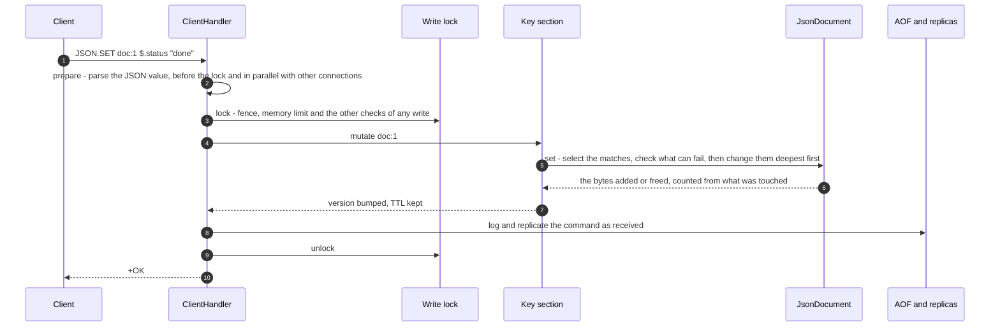

- **Memory stays exact without walking the document.** Every change reports the bytes it added or freed and the document
  adds them up, so `maxmemory` accounting costs what the command touched, not the size of the document. A test recounts a
  document from scratch after thousands of random operations and requires the two to be equal to the byte.
- **Parsing happens before the write lock.** Decoding a record is the expensive part of storing it, so `JSON.SET`, `JSON.MERGE`,
  `JSON.ARRAPPEND`, `JSON.ARRINSERT` and `JSON.STRAPPEND` parse their arguments in `RedCakeCommand.prepare` (the hook `VADD`
  introduced) on the client's own thread; connections parse in parallel and the lock covers only the change.
- **An empty object or array is a document**, and is kept (unlike an empty hash); `JSON.DEL key $` removes the key and its TTL.

**Snapshots.** A full sync, an AOF rewrite and a promotion describe each document as commands. Nearly every document is one
`JSON.SET key $ <text>`. A document can however grow far beyond what one command can carry (the parser accepts 1 MiB per
argument), so a larger one is rebuilt in pieces of public commands, which keeps the log readable and replayable anywhere:

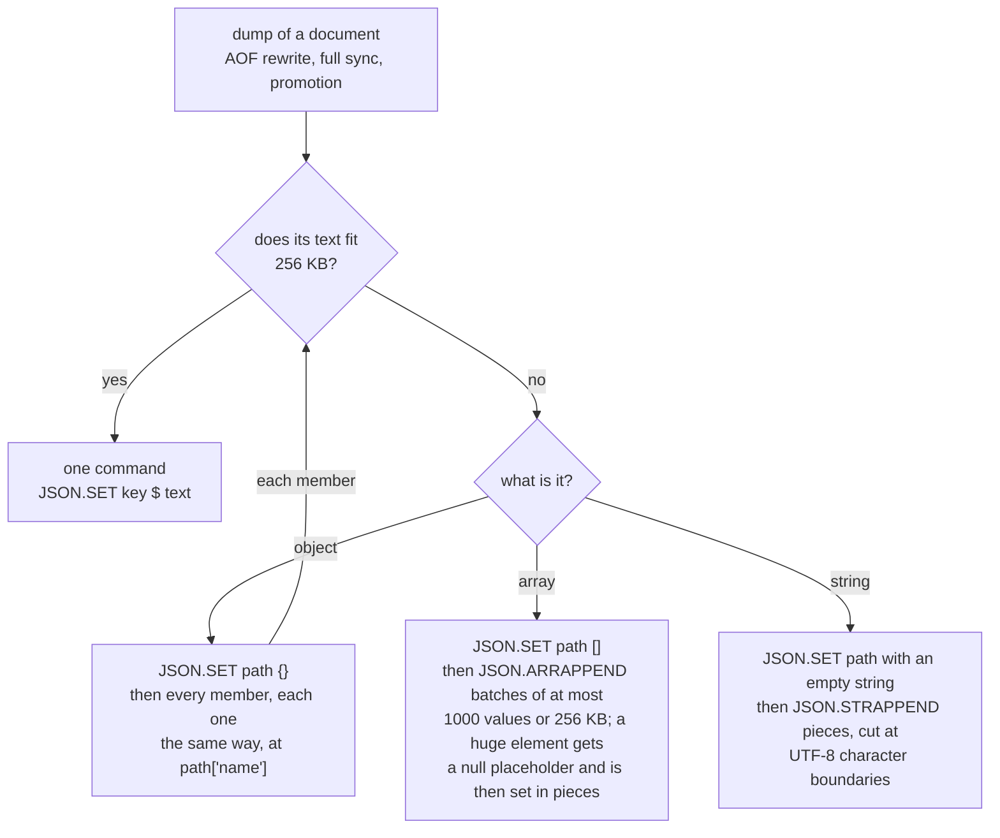

A 3.6 MB document built by 270 appends is rewritten, replayed and replicated in the tests.

**Measured** (a 6,725-byte record: 2 KB of text, a 384-dimensional embedding, nested metadata and a status; 2-core laptop shared
with a browser and an IDE, so values wobble by 10-20 %; reproduce with `scripts/json-benchmark.sh`):

| In process, one thread | |
|---|---|
| parse the record | 77,000 / s (13 us), 515 MB/s |
| write it back as text | 39,000 / s (26 us), 262 MB/s |
| select `$.status`, set it, `JSON.NUMINCRBY`, append a number to the embedding | 11-19 million / s |
| parsing on 1 / 2 / 4 threads | 75,000 / 129,000 / 148,000 per second |
| memory per record, measured on the heap | **6,258 bytes** |
| the estimate used for `maxmemory` | 7,211 bytes (115 %, on the safe side) |
| the same record as `LinkedHashMap` / `ArrayList<Double>` | 12,771 bytes (2.0x) |

Through a server over TCP (`redis-benchmark`, 50 clients, 100,000 requests, median of three runs after a warm-up; the load
generator shares the laptop with the server):

| | pipeline 1 | pipeline 16 |
|---|---|---|
| `SET`, the record as one 6.9 KB string | 21,100 / s | 29,900 / s |
| `JSON.SET`, the record as a document | 17,200 / s | 21,300 / s |
| `GET`, the whole string | 53,900 / s | 181,500 / s |
| `JSON.GET`, the whole document | 26,100 / s | 42,000 / s |
| `JSON.GET $.status` | 93,600 / s | 538,900 / s |
| `JSON.GET $.meta.tags` | 97,800 / s | 514,600 / s |
| `JSON.SET $.status` (change one field) | 90,300 / s | 268,800 / s |
| `JSON.NUMINCRBY $.attempts` | 79,000 / s | 263,200 / s |

Structure has a price on whole-record traffic: storing a record as a document runs at about 80 % of storing the same bytes as
a string (it is parsed), reading it whole at about 50 % (384 numbers are written back as text). The gain is in field access:
reading or changing one field runs at the speed of the smallest commands (about 90,000 a second unpipelined, 260,000-540,000
pipelined), moves tens of bytes instead of 6.9 KB, and is atomic.

**Not done:** `JSON.MSET`, `JSON.RESP`, `JSON.NUMPOWBY`; regular-expression filters and filter functions; queries across
documents (nothing indexes the contents of documents - keep an embedding searchable by also `VADD`ing it to a vector set under
the same id); and, as for vector sets, the replies were written from RedisJSON's documentation and **not checked against a
Redis Stack server**.

### 4.13 Streams and consumer groups

Pub/Sub forgets: a message published while nobody listens is gone, and a published message goes to *every* subscriber. A job
queue needs the opposite - **keep it until somebody has done it, give it to one worker, give it to another if that worker
dies**. That is a *stream*: an append-only log of entries (each with an id and field/value pairs) that survives restarts and
failover, that readers can come back to, and that consumer groups share out between workers (ADR 0008). RedCake implements
the Redis Streams commands, checked against Redis 7.4.2 command by command.

| | Pub/Sub | Stream with a consumer group |
|---|---|---|
| A message published while nobody is listening | lost | kept |
| Who receives it | every subscriber | exactly one worker of the group (a plain `XREAD` reader sees all of it) |
| The server restarts or fails over | all gone | in the AOF, in every replica |
| The worker dies half way | nobody knows | the entry stays *pending*; `XAUTOCLAIM` gives it to another worker |
| An idle worker | holds a subscription | `BLOCK`s on the server and is woken in about 0.3 ms (median) by the `XADD` |
| What you can ask | nothing | how many are waiting (`lag`), who has what and for how long (`XPENDING`), the history (`XRANGE`) |

**The life of a job**

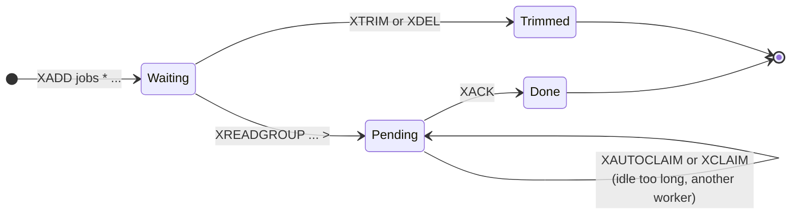

*Waiting* entries are those after the group's position; *pending* entries have been handed to a consumer and not yet
acknowledged - the group remembers who has each one, since when, and how many times it was delivered (that count is your retry
counter). Deleting a message (`XDEL`, `XTRIM`) does not make its pending entry disappear: the entry is reported without fields
until it is acknowledged or claimed.

Delivery is **at least once**: a worker that is merely slow will see its entry processed by someone else too, so a job must be
idempotent, or check the delivery count.

**Commands**

| Command | What it does |
|---|---|
| `XADD key [NOMKSTREAM] [MAXLEN\|MINID [=\|~] n [LIMIT c]] <id\|*> field value ...` | appends an entry; `*` chooses the id (millisecond clock, never going back), `ms-*` only the sequence |
| `XLEN`, `XRANGE`, `XREVRANGE` | length; a range by id, either direction, `COUNT`, `(id` to exclude |
| `XREAD [COUNT n] [BLOCK ms] STREAMS key ... id ...` | everything after an id, for any number of streams; `$` = only what arrives from now on; **`BLOCK`** waits |
| `XDEL`, `XTRIM`, `XSETID` | remove entries, cap the stream by length or oldest id, set the last id and counters |
| `XGROUP CREATE\|SETID\|DESTROY\|CREATECONSUMER\|DELCONSUMER` | manage groups (`MKSTREAM`, `ENTRIESREAD`) |
| `XREADGROUP GROUP g c [COUNT n] [BLOCK ms] [NOACK] STREAMS key ... >\|id ...` | `>`: the entries nobody in the group has been given; an id: this consumer's own pending entries after it (its history) |
| `XACK key g id ...` | these are done |
| `XPENDING key g [[IDLE ms] start end count [consumer]]` | a summary, or the pending entries with owner, idle time, delivery count |
| `XCLAIM key g c min-idle id ... [IDLE\|TIME\|RETRYCOUNT\|FORCE\|JUSTID\|LASTID]` | take specific entries over |
| `XAUTOCLAIM key g c min-idle start [COUNT n] [JUSTID]` | scan the pending list and take over what has been idle long enough; replies with where to continue |
| `XINFO STREAM [FULL [COUNT n]]`, `XINFO GROUPS`, `XINFO CONSUMERS` | length, ids, counters, groups with `lag` and `pel-count`, consumers with idle time |
| `XRESTORE` | internal, admin only: puts a pending entry back when a snapshot is loaded |

**Using it** (Python, `redis-py` - created with `protocol=2`; the whole pipeline is in [`examples/agent_pipeline.py`](examples/agent_pipeline.py))

```python
r = redis.Redis(protocol=2, decode_responses=True)
r.xgroup_create("jobs", "workers", id="0", mkstream=True)      # once

r.xadd("jobs", {"task": "embed", "doc": "doc:42"})              # producer

while True:                                                      # worker: asks the server and waits there
    for _stream, entries in r.xreadgroup("workers", "worker-1", {"jobs": ">"}, count=10, block=5000) or []:
        for entry_id, fields in entries:
            handle(fields)                                       # may raise: the entry then stays pending
            r.xack("jobs", "workers", entry_id)

# a janitor, now and then: what has been pending for a minute is given to a live worker
_next, claimed, _gone = r.xautoclaim("jobs", "workers", "janitor", min_idle_time=60_000, start_id="0-0", count=100)
```

**Recipes**

| Goal | How |
|---|---|
| Several independent consumers of one log (audit, billing, search) | one group each: `XGROUP CREATE events audit $` and `XGROUP CREATE events billing $` - every group sees every entry once, at its own pace |
| A worker restarts and must finish what it had | `XREADGROUP GROUP g w STREAMS jobs 0` returns *its own* pending entries (and counts another delivery); when that is empty, switch to `>` |
| Give up on a job after 5 tries (dead letter) | `XPENDING jobs g - + 100` lists each pending entry with its delivery count; for a count above 5: `XADD jobs:dead * ...` then `XACK jobs g <id>` |
| Keep only the last 100,000 entries / the last day | `XADD events MAXLEN 100000 * ...`, or now and then `XTRIM events MINID <millisecond timestamp>-0` |
| Has the queue drained? | `XINFO GROUPS jobs`: `lag` (not yet delivered) and `pending` (delivered, not acknowledged) are both 0 |
| Find the slowest jobs | `XPENDING jobs g IDLE 60000 - + 20` - what has been pending for over a minute, with its owner |

#### In memory

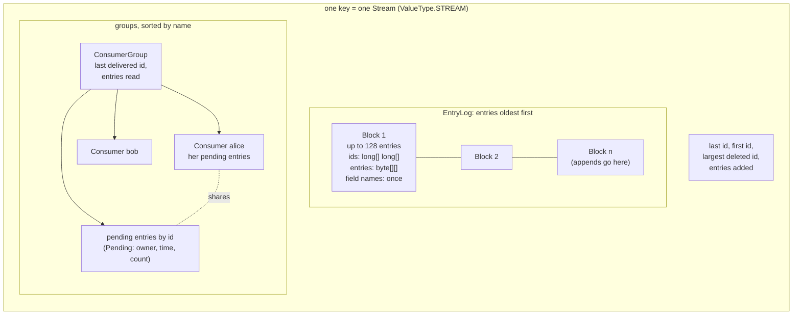

- **Blocks, not nodes.** Entries live in blocks of at most 128: a binary search over the blocks and then inside one finds an
  id; an append touches the last block; `XTRIM` drops whole blocks; a block that is mostly holes is compacted.
- **An entry is one `byte[]`** (a flag and the values with their lengths) - and *without the field names whenever they are the
  block's own*, which is nearly every entry of a real stream. A 437-byte job costs **463 bytes**, a 34-byte event 68 (see the
  table below).
- **Ids** are two unsigned 64-bit numbers (`18446744073709551615-18446744073709551615` is valid), compared unsigned.
- **An empty stream is still a key**: it keeps its last id and its groups (unlike an empty list).
- The estimate behind `--maxmemory` is kept incrementally and equals a recount to the byte (tested on thousands of random operations).

#### Waiting without holding anything

`BLOCK` parks the connection's *virtual thread* - a few hundred bytes, no worker, and, crucially, **not the write lock**. The
client is woken by the `XADD` that gives it something:

```mermaid
sequenceDiagram
    autonumber
    participant W as Worker (connection)
    participant H as ClientHandler
    participant K as KeyWaiters
    participant S as Store
    participant P as Producer
    W->>H: XREADGROUP GROUP g w BLOCK 5000 STREAMS jobs >
    H->>K: register on "jobs", note its version
    H->>S: try the command (a write: lock, execute, log, unlock)
    S-->>H: nothing yet (null array)
    H->>K: park until the version changes, 5 s pass, or the client hangs up
    Note over H,K: no lock held. Every 200 ms: is the socket still open?
    P->>S: XADD jobs * task embed
    S->>K: wake("jobs") - after the data is in place
    K-->>H: the version changed
    H->>S: cheap look: is there anything for this group?
    H->>S: run the command again (lock, execute, log, unlock)
    S-->>H: [[jobs, [[id, [task, embed]]]]]
    H-->>W: the entry
```

- **No wake-up is lost**: the waiter notes the version *before* it tries the command, and `XADD` bumps it *after* the data is
  in place. `$` in `XREAD` is replaced by the stream's last id when the command arrives, otherwise the entry that arrives
  while waiting would become "the last id" and be skipped.
- **A client that hangs up while it waits is noticed** (a one-millisecond read of its socket every 200 ms), so an `XREADGROUP`
  does not hand an entry to a worker that is no longer there. `CLIENT KILL` and stopping the server end the wait too; an idle
  timeout does not apply to a waiting connection.
- **Many readers, one entry:** all readers of the key wake, and each does a cheap lock-free look first, so only a reader that
  could receive something takes the write path. Each entry still goes to exactly one reader of a group. (Redis serves
  waiting readers first come, first served; RedCake does not promise an order.)
- Inside `MULTI` nothing waits. On a replica `XREAD BLOCK` works (replication wakes it); `XREADGROUP` is a write and gets `-READONLY`.

#### What is logged and replicated

`XREADGROUP` hands out *whatever is new right now*, `XAUTOCLAIM` *whatever has been idle long enough*: running the same
command on a replica, or from the AOF after a restart, would give different answers. So these commands do not replicate
as themselves - they report **what they did**, as plain commands every node replays the same way:

```mermaid
flowchart LR
    A["XADD jobs * ..."] -->|"id fixed under the lock"| A2["XADD jobs 1793608281293-0 ..."]
    B["XREADGROUP ... >"] -->|"what it handed out"| B2["XGROUP CREATECONSUMER<br/>XCLAIM ... FORCE JUSTID<br/>XGROUP SETID ..."]
    C["XCLAIM / XAUTOCLAIM"] -->|"what it moved"| B2
    D["XACK, XDEL, XTRIM,<br/>XGROUP ..."] -->|"deterministic: as received"| D2["the same command"]
    A2 --> L["AOF + replication backlog<br/>+ every replica, in one order"]
    B2 --> L
    D2 --> L
    S["snapshot: AOF rewrite,<br/>full sync, promotion"] -->|"XADD per entry, XSETID,<br/>XGROUP CREATE, XRESTORE per pending entry"| L
```

A replica that replays this ends with the same `XINFO STREAM ... FULL` as its primary - checked with random workloads of
hundreds of operations, and with real processes (`kill -9` plus AOF replay, `BGREWRITEAOF`, a replica joining late). Snapshots
use `XRESTORE` rather than `XCLAIM ... FORCE` because a pending entry can outlive its message (`XDEL`, `XTRIM`), and Redis's own
AOF rewrite loses those; a snapshot must not change what a client sees. Consumers' `seen-time` / `active-time` are not replicated.

#### Compared with Redis

| | |
|---|---|
| Behaviour | ported from Redis 7.4's source and replayed against a **running Redis 7.4.2**: 464 recorded commands in 11 scenarios (ids, ranges, trimming, groups, history reads, `XPENDING`, `XCLAIM`, `XAUTOCLAIM`, `lag`), error texts included, identical; `redis-py` 8.1 gives the same results for 39 of 40 calls |
| `MAXLEN ~ n`, `MINID ~ id` | RedCake trims **exactly** (Redis stops at a node boundary); `LIMIT` still bounds the work. The one `redis-py` difference |
| `radix-tree-keys`, `radix-tree-nodes` | the number of blocks (and one more) |
| Not implemented | `XDELEX`, `XACKDEL`, `KEEPREF` / `DELREF` / `ACKED`, `XREADGROUP ... CLAIM` (newer than 7.4) |

| Measured (shared 2-core laptop) | RedCake | Redis 7.4.2 |
|---|---|---|
| memory per entry: a 34-byte event / a 437-byte job | **68 B / 463 B** | 38 B / 497 B |
| the same with one `TreeMap<id, String[]>` per stream | 408 B / 903 B | |
| job queue over TCP, 8 workers, 20,000 jobs, end to end | 15.8k-17.1k jobs/s | 17.2k-20.1k jobs/s |
| an idle worker woken by an `XADD`: median / 99th percentile | 0.26-0.30 / 1.6-2.5 ms | 0.21-0.22 / 1.1-1.6 ms |
| the data structure alone: add / `XRANGE COUNT 100` / deliver 10 + ack | 2.4-7.2 M/s, 20-30k/s, 2.5-4 M/s | |

Redis packs tiny entries tighter (it delta-encodes the ids); RedCake is ahead once the values dominate. Reproduce with
`scripts/stream-benchmark.sh`. The load generator shares the machine with the server, so these are lower bounds for both.

**Limits and gaps.** Delivery is at least once. `XRANGE key - +` on a stream of millions builds the whole reply and an
`XREADGROUP` without `COUNT` takes everything new - use `COUNT`. A consumer that reads and never acknowledges grows the
pending list (it is counted in `--maxmemory`). `BGREWRITEAOF` of a very large stream runs under the write lock like every
rewrite. Details, alternatives and what was not done: [ADR 0008](docs/adr/0008-streams-and-consumer-groups.md).

### 4.14 Security

Defence in depth, from the socket to the process. The threat model and the known gaps are in [`SECURITY.md`](SECURITY.md).

```mermaid
flowchart LR
    N["1 Network<br/>loopback default<br/>protected mode<br/>TLS, mutual TLS<br/>max clients"] --> A["2 Authentication<br/>API key or<br/>ACL user<br/>15 s to log in<br/>lockout"]
    A --> Z["3 Authorization<br/>admin, readwrite,<br/>readonly roles,<br/>checked on<br/>every command"]
    Z --> I["4 Input bounds<br/>1024 arguments<br/>1 MiB per bulk<br/>8 MiB per command<br/>vector limits"]
    I --> R["5 Resources<br/>maxmemory<br/>eviction policy<br/>replica queue cap<br/>idle timeout"]
    R --> O["6 Operations<br/>non-root image<br/>systemd sandbox<br/>ZooKeeper ACLs<br/>verified TLS"]
```

| Control | How |
|---|---|
| Safe by default | binds to loopback; **refuses to listen on another address without credentials** unless `--allow-insecure` |
| Credentials | `REDCAKE_API_KEY`, `--api-key-file` (prefer these: argv is visible in `ps`); `--acl-file` with named users and roles; `--hash-password` hashes a password read from stdin |
| Roles | `admin` runs everything; `readwrite` runs every data command but no administrative one (`CONFIG`, `SLOWLOG`, `FLUSHALL`, `FLUSHDB`, `SHUTDOWN`, `MONITOR`, `BGREWRITEAOF`, `REPLICAOF`, `FAILOVER`, `PSYNC`, `REPLCONF`, `VRESTORE`, `XRESTORE`, `CLIENT KILL`, `ACL LIST` / `ACL USERS`); `readonly` runs only commands that do not modify data |
| Brute force | per-IP failure tracker (10 failures in 60 s, then 60 s lockout); new connections must authenticate within 15 s |
| TLS | `--tls-keystore` / `--tls-truststore`, `--tls-client-auth` for mutual TLS, `--tls-replication` makes replication verify certificates and host names |
| Replication channel | replicas authenticate with the API key; with `--tls-replication` they verify the primary, so a forged znode cannot capture the key |
| Parser | bounded arguments, bulk and command size; fuzz-tested. JSON: nesting limited to 128, UTF-8 validated; paths limited in length, filter nesting and work. Streams: every input bounded; pending lists and waiting connections bounded by `--maxmemory` and `--max-clients` |
| Packaging | non-root Docker user, systemd unit with sandboxing options (`deploy/redcake.service`) |

**Do not expose RedCake to an untrusted network.** It is a learning-grade store, not a hardened internet-facing service.

### 4.15 Observability

```mermaid
flowchart LR
    src["ServerStats<br/>CommandStats<br/>SlowLog<br/>ReplicationStats<br/>ClusterState"] --> info["Commands<br/>INFO, SLOWLOG,<br/>CLIENT LIST, MONITOR,<br/>CONFIG GET"]
    src --> http["HTTP on the metrics port<br/>/metrics, /health,<br/>/primary, /replica"]
    http --> prom["Prometheus"]
    prom --> graf["Grafana dashboard"]
    http --> lb["load balancer<br/>health checks"]
```

- **`INFO`** sections: `server clients memory persistence stats replication cluster commandstats keyspace`.
- **`SLOWLOG`** keeps commands slower than `--slowlog-threshold-us` (10,000 by default); **`MONITOR`** streams every command;
  **`CLIENT LIST/KILL/SETNAME`**; **`CONFIG GET/SET`** for `maxmemory`, `maxmemory-policy`, `loglevel`, `slowlog-*` at run time.
- **Prometheus** (`/metrics`): `redcake_connected_clients`, `redcake_commands_processed_total`, `redcake_command_calls_total`,
  `redcake_command_failed_total`, `redcake_command_duration_seconds` (histogram), `redcake_keys`, `redcake_keys_with_ttl`,
  `redcake_expired_keys_total`, `redcake_evicted_keys_total`, `redcake_memory_used_bytes`, `redcake_memory_limit_bytes`,
  `redcake_replication_offset_bytes`, `redcake_connected_replicas`, `redcake_replica_link_up`, `redcake_aof_enabled`,
  `redcake_aof_healthy`, `redcake_auth_failures_total`, `redcake_jvm_*`, and `redcake_cluster_*` (`is_primary`, `fenced`, `epoch`,
  `promotions_total`, ...) in cluster mode.
- **Health:** `/health` is `200` or `503` (AOF cannot be written); `/primary` and `/replica` for load balancers. The metrics
  endpoints are unauthenticated: keep that port on a private network.

### 4.16 Consistency and durability guarantees

| Scenario | What you get |
|---|---|
| Single node, `--aof-fsync always` | no acknowledged write lost on `kill -9` (checked by `scripts/crash-test.sh`) |
| Single node, `everysec` (default) | up to about one second of acknowledged writes can be lost in a crash |
| Reading from a replica | possibly stale: replication is asynchronous; the replica applies writes in the primary's order |
| `WAIT n ms` after a write | blocks until `n` replicas acknowledged it, bounding the loss window of an unplanned failover |
| Planned `FAILOVER` / graceful shutdown | no acknowledged write lost |
| Unplanned failover | writes the old primary acknowledged but no replica had received are lost (use `WAIT` / `--min-replicas-to-write`) |
| Partition or frozen primary | **at most one node acknowledges writes at a time** (lease + fencing), assuming ZooKeeper is correct and clocks run at the same *rate*; one window remains: a process frozen *between* the fence check and the reply may acknowledge one write after waking, and that write is lost rather than corrupting the new primary |
| ZooKeeper unavailable | no failover and no writes after the lease expires (a CP choice); reads continue |
| `MULTI` / `EXEC` | atomic with respect to other writers, contiguous in the AOF and stream; like Redis, no rollback of a command that fails at run time |
| A `JSON.*` command | atomic on its document, and a command that fails leaves the document untouched (everything that can fail is checked before anything changes), so what the primary logs and replicates is exactly what it applied |
| A stream entry | in the AOF and in every replica; handed to **one** worker of a group and **pending until `XACK`**; a worker that dies leaves it pending for `XAUTOCLAIM`. **At least once**: a slow worker's entry can be processed twice, so jobs must be idempotent |
| `XREADGROUP`, `XCLAIM`, `XAUTOCLAIM` | logged and replicated as what they did (`XCLAIM ... FORCE JUSTID`, `XGROUP SETID`): a replica, a replayed AOF and a node rebuilt from a snapshot end with the same groups and pending lists as the primary (random workloads, and real processes with `kill -9`) |
| A waiting `XREAD` / `XREADGROUP` | woken by the `XADD` (no wake-up is lost), never holds the write lock, and is released within 200 ms of its client hanging up, so a dead worker is not handed a job |

### 4.17 Design decisions

| ADR | Decision |
|---|---|
| [0001](docs/adr/0001-write-ordering-and-threading.md) | virtual thread per connection; all writes through one lock so the log, backlog and replicas share one order; nothing in the lock waits on the network |
| [0002](docs/adr/0002-replication-protocol.md) | RedCake-native replication over RESP: handshake, backlog, `CONTINUE` / `FULLRESYNC`, acks, `WAIT`; no RDB |
| [0003](docs/adr/0003-binary-safe-strings.md) | ISO-8859-1 "byte strings": binary-safe without rewriting the code base to `byte[]` |
| [0004](docs/adr/0004-typed-values-and-atomic-sections.md) | typed `ValueEntry`, per-key atomic `compute` sections, versions for `WATCH` and expiry |
| [0005](docs/adr/0005-zookeeper-failover.md) | ZooKeeper as source of truth, atomic epoch claim, lease + fencing, planned hand-over |
| [0006](docs/adr/0006-vector-search.md) | HNSW vector sets, int8 default, paged primitive arrays, SIMD kernel, search before the write lock, binary dump for snapshots |
| [0007](docs/adr/0007-json-documents.md) | JSON documents with RedisJSON's commands rather than a document namespace; unboxed number arrays; validate-then-apply; incremental size estimate; parse before the write lock; snapshots in pieces |
| [0008](docs/adr/0008-streams-and-consumer-groups.md) | Redis Streams rather than a queue API; blocks of packed entries; waiting without a lock (`KeyWaiters`); commands that log what they did; `XRESTORE` for exact snapshots; semantics checked against Redis 7.4.2 |

---

## 5. Command reference

164 command names: 143 in the registry (`COMMAND COUNT`, `COMMAND LIST`) plus 21 handled at the connection level (marked with *).

<details>
<summary><b>All commands by group</b> (click to expand)</summary>

| Group | Commands |
|---|---|
| Connection | `PING ECHO QUIT* AUTH* [user] SELECT(0) HELLO(2) CLIENT*(ID SETNAME GETNAME LIST INFO KILL SETINFO) COMMAND(COUNT LIST)` |
| Strings | `SET(NX XX GET EX PX EXAT PXAT KEEPTTL) GET MGET MSET MSETNX SETNX SETEX PSETEX GETSET GETDEL APPEND STRLEN GETRANGE INCR INCRBY DECR DECRBY` |
| Hashes | `HSET HMSET HSETNX HGET HMGET HDEL HEXISTS HGETALL HKEYS HVALS HLEN HINCRBY HSTRLEN` |
| Lists | `LPUSH RPUSH LPOP RPOP LLEN LRANGE LINDEX LSET LREM LTRIM` |
| Sets | `SADD SREM SMEMBERS SISMEMBER SCARD SINTER SUNION SDIFF` |
| Sorted sets | `ZADD(NX XX CH) ZREM ZCARD ZSCORE ZRANK ZINCRBY ZRANGE ZREVRANGE ZRANGEBYSCORE ZCOUNT ZPOPMIN ZPOPMAX` |
| **Vector sets** | `VADD(FP32 VALUES NOQUANT Q8 BIN EF M SETATTR) VSIM(ELE FP32 VALUES WITHSCORES WITHATTRIBS COUNT EF EPSILON TRUTH) VREM VCARD VDIM VEMB(RAW) VINFO VGETATTR VSETATTR VISMEMBER VRANDMEMBER VLINKS(WITHSCORES) VRESTORE(internal, admin)` |
| **JSON documents** | `JSON.SET(NX XX) JSON.GET(INDENT NEWLINE SPACE) JSON.MGET JSON.DEL JSON.FORGET JSON.TYPE JSON.NUMINCRBY JSON.NUMMULTBY JSON.STRAPPEND JSON.STRLEN JSON.ARRAPPEND JSON.ARRINSERT JSON.ARRINDEX JSON.ARRLEN JSON.ARRPOP JSON.ARRTRIM JSON.OBJKEYS JSON.OBJLEN JSON.TOGGLE JSON.CLEAR JSON.MERGE JSON.DEBUG(MEMORY)` |
| **Streams** | `XADD(NOMKSTREAM MAXLEN MINID LIMIT) XLEN XRANGE XREVRANGE XREAD(COUNT BLOCK) XDEL XTRIM XSETID XINFO(STREAM GROUPS CONSUMERS) XGROUP(CREATE SETID DESTROY CREATECONSUMER DELCONSUMER) XREADGROUP(GROUP COUNT BLOCK NOACK) XACK XPENDING(IDLE) XCLAIM(IDLE TIME RETRYCOUNT FORCE JUSTID LASTID) XAUTOCLAIM(COUNT JUSTID) XRESTORE(internal, admin)` |
| Keys | `DEL UNLINK EXISTS KEYS(glob) TYPE RENAME DBSIZE FLUSHDB FLUSHALL RANDOMKEY` |
| Expiry | `EXPIRE PEXPIRE EXPIREAT PEXPIREAT(NX XX GT LT) EXPIRETIME PEXPIRETIME TTL PTTL PERSIST` |
| Pub/Sub | `SUBSCRIBE* UNSUBSCRIBE* PSUBSCRIBE* PUNSUBSCRIBE* PUBLISH PUBSUB` |
| Transactions | `MULTI* EXEC* DISCARD* WATCH* UNWATCH*` |
| Replication / HA | `REPLICAOF* / SLAVEOF* (incl. NO ONE)  ROLE  WAIT*  PSYNC*  REPLCONF*  FAILOVER*` |
| Operations | `INFO(server clients memory persistence stats replication cluster commandstats keyspace) CONFIG(GET SET) SLOWLOG MONITOR* ACL*(WHOAMI LIST USERS) BGREWRITEAOF* SHUTDOWN TIME` |

</details>

Semantics follow Redis: `EXPIRE k 0` deletes the key, `TTL` rounds to the nearest second, collections vanish when empty, `WRONGTYPE`
protects against type confusion, inline commands (`telnet` / `nc`) work, and values are **binary-safe**.
`DifferentialRedisTest` compares RedCake's replies with a real `redis-server` for about 220 commands when one is on the PATH; against Redis
7.4.2 every reply matched, and `StreamGoldenTest` does the same for 464 stream commands without needing Redis installed.

**Not implemented:** `SCAN`, blocking list operations (`BLPOP` and friends; the machinery they need exists since streams), Lua
scripting, RESP3 (`HELLO 3`), sharded cluster, `SPOP` / `SRANDMEMBER` (non-deterministic, see ADR 0004), for vector sets `FILTER` /
`REDUCE`, `JSON.MSET`, `JSON.RESP`, `JSON.NUMPOWBY`, and the stream commands newer than Redis 7.4 (`XDELEX`, `XACKDEL`, `XREADGROUP ... CLAIM`).

---

## 6. Configuration

Options are command-line flags or lines of a file (`--config redcake.conf`, the same names without `--`; see
`deploy/redcake.conf.example`). **The command line wins.** Startup rejects unknown options, missing values, duplicates and
out-of-range numbers with one readable line (exit code 2). Secrets do not belong in the file: use the environment variables and
`*-file` options.

<details>
<summary><b>All options</b> (click to expand)</summary>

| Area | Option | Meaning (default) |
|---|---|---|
| Network | `--port N`, `--bind ADDR` | listener (6379, 127.0.0.1) |
| | `--max-clients N`, `--timeout S` | client cap (10000), idle disconnect (0 = never; unauthenticated connections always 15 s) |
| Security | `REDCAKE_API_KEY`, `--api-key-file`, `--api-key` | require `AUTH` (prefer env/file: argv is visible in `ps`) |
| | `--acl-file PATH`, `--hash-password` | named users with roles; hash a password read from stdin |
| | `--allow-insecure` | permit a non-loopback bind without credentials (refused by default) |
| | `--tls-keystore`, `--tls-truststore`, `--tls-*-password-file`, `--tls-client-auth`, `--tls-replication` | TLS, mutual TLS, TLS replication (passwords also via `REDCAKE_TLS_*_PASSWORD`) |
| Persistence | `--aof-file PATH`, `--aof-fsync always\|everysec\|no` | append-only file (off), durability (everysec) |
| Memory | `--maxmemory SIZE`, `--maxmemory-policy noeviction\|allkeys-random\|volatile-ttl` | limit (0 = none), policy (noeviction) |
| Replication | `--replicaof HOST PORT`, `--repl-backlog-size SIZE` | follow a primary, partial-resync buffer (1mb) |
| | `--min-replicas-to-write N`, `--min-replicas-max-lag S` | refuse writes (`-NOREPLICAS`) unless N replicas acknowledged within S seconds (off, 10) |
| Failover | `--zk-connect HOSTS` | **turns automatic failover on**: `host:port[,host:port...][/chroot]`; excludes `--replicaof` |
| | `--cluster-name`, `--node-id`, `--advertise-host`, `--advertise-port` | znode namespace (redcake), unique node name (`host:port`), address others use to reach this node |
| | `--replica-priority N` | lower is promoted first, `0` never (100) |
| | `--zk-session-timeout-ms`, `--zk-connection-timeout-ms`, `--cluster-election-delay-ms` | failure detection time (10000), connect timeout (5000), quiet time before promoting (1000) |
| | `REDCAKE_ZK_AUTH`, `--zk-auth-file` | `user:password` for ZooKeeper digest authentication |
| Ops | `--metrics-port N`, `--slowlog-threshold-us N`, `--config PATH` | Prometheus / health endpoint (off), slow log (10000), config file |

</details>

**JVM options**

| Option | Purpose |
|---|---|
| `--add-modules jdk.incubator.vector` | SIMD vector kernel (check `java --list-modules \| grep vector` first: a JVM without the module refuses to start with the flag) |
| `-Dredcake.vector.kernel=auto\|scalar\|simd` | choose the kernel (`auto` is the default; `simd` fails at startup if unavailable) |
| `-XX:+UseZGC -XX:MaxRAMPercentage=75` | what the Docker image and the systemd unit use |

**Runtime changes:** `CONFIG SET maxmemory | maxmemory-policy | loglevel | slowlog-log-slower-than | slowlog-max-len`.

---

## 7. Deployment

### Single node

```bash
export REDCAKE_API_KEY="$(openssl rand -hex 24)"     # keep a copy: clients need it for AUTH
java -XX:+UseZGC -jar redCake.jar --bind 0.0.0.0 --aof-file /var/lib/redcake/redcake.aof \
     --maxmemory 1gb --maxmemory-policy allkeys-random --metrics-port 9100
```

`deploy/redcake.service` is a sandboxed systemd unit (dedicated user, read-only filesystem except the data directory, no
capabilities, `LimitNOFILE=65535`, graceful stop that flushes the AOF). `deploy/redcake.conf.example` documents every option.

### Primary and replicas (`docker-compose.yml`)

```mermaid
flowchart LR
    subgraph compose["docker compose up --build"]
        P["primary<br/>6379, metrics 9100<br/>AOF volume"]
        R1["replica1<br/>host port 6381"]
        R2["replica2<br/>host port 6382"]
        P ==>|replication| R1
        P ==>|replication| R2
    end
    mon["monitoring profile<br/>Prometheus 9090<br/>Grafana 3000"] -.->|scrape| P
```

### Self-electing cluster (`docker-compose.cluster.yml`)

```mermaid
flowchart TB
    cl["clients"] --> hp["HAProxy - profile lb<br/>6400 writes, 6401 reads"]
    hp -->|"writes: the node that answers 200 on /primary"| n1
    hp -.->|"reads: nodes that answer 200 on /replica"| n2
    hp -.-> n3

    subgraph c["docker compose -f docker-compose.cluster.yml up --build"]
        n1["node1 - 6379"]
        n2["node2 - 6380"]
        n3["node3 - 6381"]
        zk[("zookeeper 3.9")]
    end
    n1 --- zk
    n2 --- zk
    n3 --- zk
```

One ZooKeeper is enough to try it out; **run a 3- or 5-member ensemble in production** and list every member in `--zk-connect`.
Try the failover: `docker compose -f docker-compose.cluster.yml kill node1`, then `redis-cli -p 6380 INFO cluster` (a replica
takes over in about 12 s), and `redis-cli -p 6380 FAILOVER` for a planned hand-over. `deploy/haproxy.cfg.example` shows how a
load balancer follows the primary using the health endpoints. The cluster compose file and the HAProxy configuration were
written for this project but not executed in the authoring environment; `scripts/failover-test.sh` is the verified way to
exercise failover with real processes.

### Monitoring

`--metrics-port 9100`, scrape `deploy/prometheus.yml` (or `prometheus-compose.yml`), import `deploy/grafana-dashboard.json`.

### Sizing notes

- Memory: set `--maxmemory` well below the heap (`MaxRAMPercentage`), the accounting is an estimate and snapshots copy entries.
- Every client connection is a virtual thread; `--max-clients` (10,000) is the guard rail. 2,000 concurrent clients were measured.
- With failover: keep session timeout at 5 s or more, three or five ZooKeeper members, the same API key on all nodes, and a unique
  reachable `--advertise-host` per node.

---

## 8. Performance

Measured on a laptop (2 cores / 4 threads, JDK 22), loopback, **shared with a browser and an IDE**: treat differences under about
10 % as noise. Raw notes: [`docs/benchmarks.md`](docs/benchmarks.md). Reproduce with `scripts/benchmark.sh` (`redis-benchmark`).

| Scenario (`redis-benchmark`, 200k requests) | req/s |
|---|---|
| SET / GET / INCR, 50 clients | ~91k / ~102k / ~107k |
| SET / GET / INCR, 50 clients, pipeline `-P 16` | ~368k / ~1.10M / ~553k |
| GET, 2,000 clients | ~67k |
| SET / GET with 1 KiB values | ~90k / ~113k |
| LPUSH / SADD / HSET / ZADD (100k, 50 clients) | ~77k / ~104k / ~105k / ~106k |

**Why pipelining improved about 20x:** the first handler flushed the socket after every reply; the current one buffers replies and
flushes only when no more request bytes are waiting. **Why the unpipelined numbers are flat:** one request is one network round trip,
so the loopback and thread hand-off dominate; further gains need a different I/O model.

**Adding vector search did not slow the existing commands.** The same `redis-benchmark` workload (`-c 50 -P 16 -d 64`, 300k requests,
JIT warm-up first) against the jar built from the previous commit and the jar with vector search, **6 alternating rounds, medians**:

| | before | with vector search | ratio |
|---|---|---|---|
| SET | 373k/s | 359k/s | 96 % |
| GET | 810k/s | 794k/s | 98 % |
| INCR | 462k/s | 461k/s | 100 % |
| HSET | 285k/s | 279k/s | 98 % |
| ZADD | 306k/s | 317k/s | 104 % |
| LPUSH (single growing list, O(n) head insert) | 16.8k/s | 16.9k/s | 101 % |

The runs wobbled by 10-20 % between rounds on this shared machine, so these ratios show "no measurable regression", not an
improvement or a loss of 2-4 %. Vector numbers are in [4.11](#411-vector-search) and ADR 0006.

**Adding streams did not measurably slow the existing commands.** The same `redis-benchmark` workload (`-c 50 -P 16 -d 64`, a fresh JVM
per run, a warm-up run first) against the jar of the previous commit and the jar with streams, **6 pairs of runs in alternating order, the
server and the load generator pinned to separate cores**; the ratio is the median of the six pairs:

| | before | with streams | ratio |
|---|---|---|---|
| SET | 401k/s | 358k/s | 94 % |
| GET | 682k/s | 655k/s | 97 % |
| INCR | 478k/s | 431k/s | 94 % |
| HSET | 352k/s | 319k/s | 95 % |
| ZADD | 379k/s | 355k/s | 100 % |
| LPUSH (single growing list, O(n) head insert) | 49k/s | 46k/s | 97 % |

On this shared machine (load average above 3 on four hardware threads) single pairs ranged from 66 % to 157 %, so read this as "no loss
that stands out from the noise", not as 94 % or 97 % exactly. Two earlier comparisons (unpinned, always the old jar first) gave medians
between 82 % and 118 % per command - SET, GET, INCR and LPUSH moved in both directions, HSET and ZADD stayed below 100 % (82-92 %) -
and the first of them showed the writes 8-12 % lower, which led to making the thread-local bookkeeping that only `XREADGROUP`, `XCLAIM`
and `XAUTOCLAIM` need opt-in (`RedCakeCommand.reportsEffects`) instead of something every write pays for. A follow-up of 10 more pairs
for HSET and ZADD alone gave 94.5 % and 99.7 %: a loss of a few percent for HSET is possible, and this machine cannot tell it from noise.

**Streams** are measured in [4.13](#413-streams-and-consumer-groups) and ADR 0008: a job queue over TCP (8 workers, 20,000 jobs,
the load generator on the same laptop) runs at 15.8k-17.1k jobs a second end to end against 17.2k-20.1k for Redis 7.4.2, an idle
worker is woken by an `XADD` in 0.26-0.30 ms (median), and an entry costs 68 bytes (a 34-byte event) or 463 bytes (a 437-byte job)
on the heap - a `TreeMap` of arrays needs 408 and 903.

**JSON documents** are measured in [4.12](#412-json-documents) and ADR 0007. In short: a 6.7 KB record parses at 77,000 / s and
takes 6.3 KB on the heap (half of what maps and boxed numbers need); through a server, reading or changing **one field** of
it runs at 79,000-98,000 requests a second unpipelined (263,000-539,000 pipelined) - the speed of the smallest commands -
where moving the whole record as a string manages 21,000-54,000 and is not atomic per field.

---

## 9. Testing

```bash
./mvnw clean verify                 # 494 tests
scripts/smoke-test.sh 6379          # redis-cli checks against a running server
scripts/crash-test.sh 5             # kill -9 recovery with --aof-fsync always
scripts/soak-test.sh 60             # memory-growth watch under load (use 1440 for a 24 h soak)
scripts/benchmark.sh 6379 200000    # redis-benchmark scenarios
scripts/vector-benchmark.sh         # vector index + server benchmarks, both kernels
scripts/json-benchmark.sh           # JSON documents: speed, memory per record, server throughput
scripts/stream-benchmark.sh         # streams: memory per entry, job-queue throughput, wake-up latency (a redis-server adds a comparison)
python3 examples/agent_pipeline.py  # JSON record + stream of jobs + vector set, end to end (pip install redis)
mvn test -Dtest=StreamGoldenTest -Dredcake.golden.record=127.0.0.1:6379   # re-record the stream transcript from a live Redis
scripts/failover-test.sh            # real processes + an existing ZooKeeper: kill -9, planned FAILOVER, SIGSTOP, SIGTERM
./mvnw -Pcoverage verify            # JaCoCo gate (needs network; not run in the authoring environment)
```

| Area | Tests | What is checked |
|---|---|---|
| Options and config | 16 | strict parsing, authentication config |
| RESP protocol | 13 | incremental parser, malformed input, fuzzing |
| Commands | 30 | Redis semantics, typed values, `WRONGTYPE`, `MULTI`/`EXEC` |
| Store | 18 | atomic sections, expiry, glob matching |
| Append-only file | 7 | write, replay, torn tail, rewrite |
| Replication | 28 | backlog, partial and full resync, `WAIT`, min-replicas, snapshot copy |
| Failover | 70 | election policy, znode records, write fence, **end-to-end failover with real nodes and an embedded ZooKeeper** |
| Server end to end | 60 | real sockets in one JVM: ACL, TLS, memory limit, pub/sub, transactions, connection limits |
| Metrics and stats | 9 | Prometheus text, replication history |
| Vector search | 65 | index (recall, delete and repair, restore validation incl. bit-flip fuzzing, both kernels), commands, replication and AOF of vector sets |
| JSON documents | 99 | parser (invalid input, UTF-8, depth, numbers against `Double.parseDouble`), writer, both containers against Java collections under random operations, JSONPath against a reference implementation, the document operations (RFC 7386 vectors; 10,000+ random operations where a failure must leave the document unchanged and the byte count must stay exact), snapshots of documents up to 6 MB, the 22 commands in both dialects, and a real server: roles, `maxmemory`, AOF replay and rewrite, replication, `MULTI` / `WATCH`, concurrent clients |
| Streams | 78 | ids (unsigned); the entry log against a `TreeMap` under 40 seeds of random operations with the size estimate recounted; the stream rules with a controlled clock; what each command logs; **a replica, a replayed log and a snapshot-rebuilt node all end with the primary's groups and pending lists** (random workloads); 19 tests through sockets (a reader that waits and is woken, a client that hangs up, **600 jobs through 6 workers, each processed exactly once**, a dead worker's jobs claimed by another, roles, `maxmemory`, AOF, replication); one over TLS; and **464 commands replayed against the replies of a real Redis 7.4.2** |
| Spring context | 1 | the application starts |

`DifferentialRedisTest` runs only when `redis-server` is on the PATH (it is skipped otherwise). Run against **Redis 7.4.2**, built
from source, every one of its roughly 220 commands gets the same reply from RedCake (`SELECT 1` was taken out of its script: Redis
accepts it, RedCake has a single database and refuses it). `StreamGoldenTest` needs no Redis installation: it replays the recorded
answers of that Redis to 464 stream commands. The `JSON.*` replies cannot be compared this way - plain Redis has no RedisJSON - and
follow its documentation; they were **not** checked against a Redis Stack server.

---

## 10. Troubleshooting

| Symptom | Cause and fix |
|---|---|
| `Unable to bind ... port may already be in use` | `ss -ltnp \| grep -E ':6379\|:6381'` |
| `Refusing to listen on ... without authentication` | set `REDCAKE_API_KEY`, bind to loopback, or add `--allow-insecure` |
| Replica log `Primary rejected PSYNC` / `Primary authentication failed` | version mismatch / different API keys |
| Replica log `Replica connection lost: ... PKIX` or `No subject alternative names` | the primary's certificate is not in the replica's `--tls-truststore`, or does not list the host name used in `--replicaof` |
| Clients get `-LOADING` | a replica is applying a full snapshot, or a cluster node has no trusted dataset yet; retry (`INFO replication` shows `master_link_status`) |
| Clients get `-CLUSTERDOWN` | no writable primary: see `INFO cluster` (`cluster_state`, `cluster_zk_state`, `cluster_election`) |
| Replica log `Primary rejected PSYNC: -NOTPRIMARY` | pointed at a node that is not (yet) the elected primary; in cluster mode nodes find the primary themselves and retry within a fraction of a second |
| Cluster node stays `joining` | it cannot reach ZooKeeper: check `--zk-connect`, the firewall, `--zk-connection-timeout-ms` |
| `cluster_election` says the data is older than the last leader's epoch | bring back the node with the newest data; last resort in [4.10](#410-high-availability-automatic-failover) |
| Clients get `-OOM` | `maxmemory` reached under `noeviction`: delete data, raise the limit, or pick an eviction policy |
| Clients get `-MISCONF`, `/health` is 503 | the AOF cannot be written (disk full, permissions): fix the disk; writes resume |
| `VADD` / `VSIM` slower than expected | the log says `Vector search kernel: scalar`: start the JVM with `--add-modules jdk.incubator.vector` |
| JVM fails with `Module jdk.incubator.vector not found` | this JRE does not ship the module: remove the flag (RedCake falls back to the scalar kernel) |
| `VSIM` returns different neighbours than an exact scan | HNSW is approximate: raise `EF` (and `M` at build time), or use `TRUTH` for an exact answer |
| `redis-py` fails to connect with `NOPROTO sorry, this protocol version is not supported` | it asks for RESP3 first and does not fall back: create the client with `protocol=2` (other RESP2 clients are unaffected) |
| `JSON.SET key $.a ...` answers `new objects must be created at the root` | a document is created by setting its root: `JSON.SET key $ '{...}'` first, then paths |
| `JSON.*` answers `invalid JSON: ... at offset N` | the text is not strict JSON (single quotes, trailing comma, comments, `NaN`), or its bytes are not valid UTF-8; the offset is a byte position |
| `Path '.x' does not exist` / `wrong type of path value - expected array but found string` | legacy paths (not starting with `$`) fail when there is no such value or it has the wrong type; a `$` path answers `[]` or `nil` entries instead |
| `-NOGROUP No such key 'k' or consumer group 'g'` | the stream or the group does not exist: `XGROUP CREATE k g $ MKSTREAM` first (it also answers a reader that was waiting when the key was deleted or the group destroyed) |
| `-BUSYGROUP Consumer Group name already exists` | `XGROUP CREATE` on an existing group: harmless, ignore it at start-up |
| `XADD` answers `The ID specified in XADD is equal or smaller than the target stream top item` | an explicit id must be larger than the last one (even if that entry was deleted); use `*` |
| `XREADGROUP ... >` keeps returning nil | nothing is new for this group: look at `XINFO GROUPS` (`lag`, `last-delivered-id`) - a group created with `$` does not see older entries; `XGROUP SETID k g 0` starts it over |
| entries stay in `XPENDING` for ever | the consumers never `XACK` (or died): give them to a live one with `XAUTOCLAIM k g c <min-idle-ms> 0`, and `XGROUP DELCONSUMER` the dead ones |
| the pending list grows without bound | a consumer reads and does not acknowledge; pending entries count against `--maxmemory` |
| `XTRIM ... MAXLEN ~ n` removed more than Redis would | RedCake trims exactly; `~` is accepted and means the same as `=` |
| a job was processed twice | delivery is at least once: a slow worker's entry was claimed by another; make jobs idempotent, or check the delivery count in `XPENDING` |
| `JSON.*` answers `the path is too expensive to evaluate on this document` | the path would visit more than 10 million nodes (`$..*..*..*...`, nested filters): make it more specific |
| a JSON number comes back as `1.0E10` or an integer as a double | an integer outside 64 bits is stored as a double, and doubles are written with the shortest text that reads back as the same value (`1.0E10` is valid JSON) |

---

## 11. Limitations and roadmap

**Known limitations**

- Collections are plain Java structures: `LPOP` / `LPUSH` on huge lists and `ZRANK` are O(n); `KEYS` is O(keyspace). No `SCAN`.
- All writes are serialized by one lock (correct and simple, ADR 0001); it is the ceiling for write throughput.
- Replication is RedCake to RedCake (own handshake, not an RDB stream); chaining is not supported; Pub/Sub is not replicated (streams are) and a
  stuck subscriber can slow its publisher.
- Failover keeps replication asynchronous: an unplanned failover can lose acknowledged writes no replica had received. No ZooKeeper
  majority means no failover and no writes. Without `--zk-connect` there is no automatic failover.
- `maxmemory` uses estimates; `BGREWRITEAOF` and the full-sync snapshot copy briefly pause writers.
- Vector sets: no `FILTER` / `REDUCE`; attributes are stored but not filterable; the Vector API is still incubating in the JDK; Redis 8
  compatibility is unverified; inserting from many connections at once did not get faster on the 2-core test machine (it did
  in-process); the graph on a replica is equivalent to the primary's, not always identical.
- JSON documents: `JSON.MSET`, `JSON.RESP` and `JSON.NUMPOWBY` are missing; filters have no regular expressions or functions;
  integers beyond 64 bits become doubles; nothing indexes or queries the contents of documents (an embedding inside a record
  is not searchable - put it in a vector set too); a document is one large value, so eviction removes it whole and a snapshot
  copies its text under the key's lock; replies follow RedisJSON's documentation and were **not checked against a Redis Stack
  server**.
- Streams: delivery is at least once; `MAXLEN ~` / `MINID ~` trim exactly; tiny entries cost more than in Redis (68 bytes against
  38 for a 34-byte event, the values dominate from about 100 bytes); readers blocked on one key are not served in the order they
  came; `XDELEX`, `XACKDEL` and `XREADGROUP ... CLAIM` (newer than Redis 7.4) are missing; compared with Redis 7.4.2 only;
  `BGREWRITEAOF` of a stream of millions of entries pauses writers; a reply is as large as the range asked for (use `COUNT`).
- The cluster compose file and the HAProxy example were not executed in the authoring environment.
- RESP2 only (clients that ask for RESP3 first need `protocol=2` or the equivalent); no Lua, blocking list operations or sharded cluster.

**Roadmap.** `Task.md` holds the audit, the phased checklist and the progress log. Open directions: an event-loop I/O model for very
high connection counts, background (non-blocking) AOF rewrite, `SCAN`, filtered vector search, `BLPOP` / `BRPOP` / `BLMOVE` on the
waiting machinery streams introduced, delta-encoded ids to shrink tiny stream entries, and Raft inside RedCake as the long-term
alternative to ZooKeeper (see the alternatives in ADR 0005).

---

## 12. Repository map and documentation

```text
redCake/
├── src/main/java/me/niteshh/redcake/
│   ├── cli/ config/            option parsing, immutable config
│   ├── server/ resp/           listener, per-connection pipeline, RESP codec
│   ├── command/                router, command interfaces, commands/{reads,write,types}
│   ├── store/                  keyspace, expiry, memory limit, sorted set
│   ├── vector/                 HNSW index, quantization, SIMD and scalar kernels
│   ├── json/                   JSON documents: parser, writer, JSONPath, the document and its operations
│   ├── stream/                 streams: entry log (blocks of packed entries), ids, consumer groups, pending lists
│   ├── persistence/            append-only file, expiry propagation
│   ├── replication/            primary side, replica side, backlog
│   ├── cluster/                ZooKeeper failover: coordinator, election, write fence
│   └── security/ pubsub/ stats/ metrics/
├── src/test/java/              494 tests (unit, in-JVM end to end, failover with embedded ZooKeeper)
├── src/test/resources/streams/ the stream scenarios and what a real Redis 7.4.2 answered to them
├── examples/                   agent_pipeline.py: JSON record + stream of jobs + vector set
├── scripts/                    smoke, crash, soak, benchmark, vector-, json- and stream-benchmark, failover
├── deploy/                     systemd unit, config example, Prometheus, Grafana, HAProxy
├── docs/                       adr/0001-0008, running-with-zookeeper.md, benchmarks.md
├── Dockerfile  docker-compose.yml  docker-compose.cluster.yml
└── README.md  SECURITY.md  Task.md
```

| Document | What is in it |
|---|---|
| [`docs/adr/`](docs/adr) | the eight architecture decision records (context, decision, alternatives, consequences) |
| [`examples/agent_pipeline.py`](examples/agent_pipeline.py) | a runnable pipeline: a JSON record per document, a stream of jobs with a consumer group, a vector set, a worker that dies |
| [`docs/running-with-zookeeper.md`](docs/running-with-zookeeper.md) | step-by-step guide to running a failover cluster: ZooKeeper, nodes, tests, failure drills, tuning |
| [`docs/benchmarks.md`](docs/benchmarks.md) | benchmark method and results |
| [`SECURITY.md`](SECURITY.md) | threat model, known gaps, hardening checklist, how to report a vulnerability |
| [`Task.md`](Task.md) | the audit, the roadmap and the progress log |

<details>
<summary><b>Glossary</b> (click to expand)</summary>

| Term | Meaning |
|---|---|
| RESP | the Redis serialization protocol; RedCake speaks version 2 |
| AOF | append-only file: a log of every write command, replayed at startup |
| Normalization | rewriting a command into a deterministic form before it is logged or replicated (relative times become absolute) |
| Backlog | ring buffer of the most recent replication stream bytes; makes partial resync possible |
| `replid`, offset | the id of a replication history and the byte position inside its stream |
| PSYNC | a replica's request to continue from `replid` + offset (partial) or to start over (full) |
| Epoch | a number granted once per leader election; it only grows |
| Lease | the time-limited right of a primary to accept writes; renewed by proving it still owns `/leader` |
| Fencing | refusing writes whenever the right to write cannot be proven |
| Znode | a node in ZooKeeper's tree; an *ephemeral* znode disappears with its owner's session |
| HNSW | Hierarchical Navigable Small World: a layered graph for approximate nearest-neighbour search |
| `EF` | exploration factor: how many candidates a graph search (or insert) keeps; larger is slower and more accurate |
| `M` | links per node in the graph (layer 0 holds up to 2 M) |
| Quantization | storing vectors with fewer bits (int8, 1 bit) to save memory |
| JSONPath | a query language for JSON (`$.items[?(@.price < 10)]`); RedCake accepts it, and RedisJSON's older "legacy" paths, in `JSON.*` commands |
| `ReJSON-RL` | the type name `TYPE` reports for a JSON document (the name RedisJSON uses) |
| Merge patch | RFC 7386: an object merged into another member by member, `null` deleting, everything else replacing - `JSON.MERGE` |
| Unboxed array | an array of numbers kept as a `long[]` or `double[]` instead of an array of `Long` / `Double` objects: 8 bytes a number instead of about 20 |
| Stream | an append-only log of entries (an id plus field/value pairs); kept in the AOF and replicated, unlike Pub/Sub messages |
| Entry id | `<milliseconds>-<sequence>`, two unsigned 64-bit numbers; `XADD ... *` makes one that always grows |
| Consumer group | a named position in a stream shared by workers: each entry after it goes to one consumer |
| Pending entry (PEL) | an entry handed to a consumer and not yet acknowledged; the group remembers who has it, since when and how often it was delivered |
| `XACK` / `XAUTOCLAIM` | "this entry is done" / "give me the entries that have been pending too long" - how a dead worker's jobs are recovered |
| At least once | a job is delivered until it is acknowledged, so it can be delivered twice; the job must tolerate that |
| `BLOCK` | a read that waits on the server until there is something to return; here a parked virtual thread that holds no lock |
| Recall@k | the share of the true k nearest neighbours that a search returns |
| SIMD | one instruction on many numbers at once; here the JDK Vector API |
| Virtual thread | a lightweight JDK 21 thread; blocking I/O does not tie up an operating-system thread |

</details>

---

## 13. Contributing, security, license

**Contributing.** `./mvnw clean verify` builds and runs everything (about a minute and a half: it includes TLS tests and the failover tests,
which start an embedded ZooKeeper, so no external service is needed). Run it before opening a pull request. The ground rules the
code base follows:

1. **Test first for bugs:** add a failing test that reproduces it, then fix it.
2. **One class per command** (or a `CommandProvider` with `LambdaCommand`s for a family). A command declares `isWrite()`,
   `growsMemory()` and `isAdmin()`; a write command that uses relative times overrides `normalize()` so replicas and the AOF
   receive absolute times.
3. **Never block on the network while holding the primary write lock** (ADR 0001). Read-only work that can happen first (as in
   `VADD`) goes into `RedCakeCommand.prepare`, which runs before the lock (ADR 0006); a command that must *wait* (as `XREAD BLOCK`)
   implements `RedCakeCommand.blocking`, and one whose effect cannot be replayed from its arguments (as `XREADGROUP`) reports what
   it did through `Propagation` (ADR 0008).
4. **Mutations go through `KeyValueStore`** (atomic `compute` sections); never touch collections outside it.
5. Write Javadoc that explains *why*, not just *what*, and match the surrounding style.
6. Update this README and `Task.md` when behaviour changes, and add an ADR for architectural decisions.

Pull requests should be small and focused, come with tests, and describe user-visible changes and any new security surface.
The vector tests run both distance kernels; the build starts the test JVM with `--add-modules jdk.incubator.vector`, and on a JDK
without that module the SIMD tests are skipped.

**Security.** See [`SECURITY.md`](SECURITY.md) for the threat model, the known gaps, a hardening checklist and how to report a
vulnerability privately.

